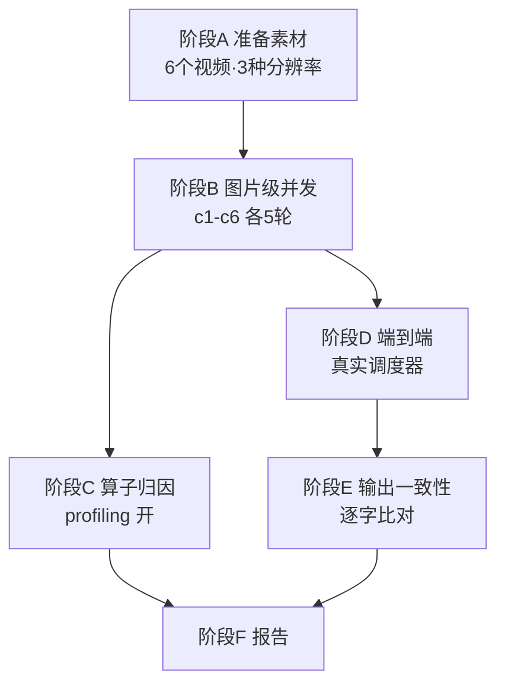

# OCR 并发测试：过程、分析与结论

本文记录 2026-10-31 一次从零开始的完整验证，说明测试怎么设计、数据怎么读、结论怎么来。

- 正式报告（数据表与复现命令）：[backend/OCR_CONCURRENCY_REPORT_2026-10-31.md](../backend/OCR_CONCURRENCY_REPORT_2026-10-31.md)
- 原始数据：`backend/data/ocr_bench_2026-10-31/`（约 1.3 GB，被 Git 忽略）

---

## 1. 要回答的问题

**OCR-only 的业务，`TASK_GPU_SLOTS` 和 `TASK_CPU_SLOTS` 该设几？**

为什么这是个真问题：`backend/app/services/task_limits.py` 里硬性要求 `gpu == 1`，所以"设几"从未被验证过。

之前只有 2026-10-16 的 Whisper 压测，但它测的是**线程并发**（`num_workers` → CTranslate2 `inter_threads`），和"同时跑几个 OCR 任务"不是同一个旋钮。两者不能互相引用。

---

## 2. 测试设计：为什么分四个阶段



分阶段的原因：图片级单组只要 5~40 秒，能快速扫出性能曲线；但它测不到真实调度器的排队行为。端到端单组要 2~3 分钟，能测到用户实际等待。所以**先用图片级找候选档位，再用端到端验证决策**。

---

## 3. 阶段A：素材准备

先验证 6 个素材**是否真有硬字幕**。如果 OCR 提取不到文字，测出来的耗时就没有代表性。

| 素材 | 结果 | 字幕段数 |
|---|---|---:|
| editor_gaps | success | 11 |
| landscape_fourth | success | 12 |
| landscape_game | success | 20 |
| landscape_second | success | 18 |
| portrait_second | success | 19 |
| portrait_speech | success | 16 |

全部有字幕。再用 `ffmpeg -stream_loop` 生成长版本：

| 素材 | 时长 | 分辨率 |
|---|---:|---|
| editor_gaps | 60s | 768×480 |
| landscape_game | 120s | 1920×1080 |
| portrait_second | 120s | 1080×1920（竖屏） |
| landscape_second | 180s | 1920×1080 |
| portrait_speech | 180s | 1080×1920（竖屏） |
| landscape_fourth | 300s | 768×480 |

**为什么要多分辨率**：OCR 耗时与输入尺寸强相关，单一分辨率得出的结论不可靠。

数据集由 `scripts/bench_ocr_prepare_mixed.py` 生成，144 帧（每视频 24 帧均匀采样），而非原先 `profile_ocr.py prepare` 的单视频做法。

---

## 4. 阶段B：图片级并发

### 4.1 为什么跑两组

生产 OCR 有两个尺寸完全不同的阶段：

```python
# backend/app/services/hard_subtitle_extractor.py:213
# 定位扫描：缩到 1280 宽，全画面
for ts, image in self.frames(video_path, 2., max_width=1280):

# backend/app/services/hard_subtitle_extractor.py:252
# 提取阶段：裁出字幕 ROI
band = self._crop(image, block['roi'])
```

因此分两组：

- **ROI 组**（裁剪后的字幕条）→ 对应提取阶段
- **全画面组**（1280 宽）→ 对应扫描阶段

### 4.2 ROI 结果（生产提取阶段负载）

| 并发 | 轮次 | 中位墙钟 | 吞吐 | 相对 c1 | 单图 P95 | 显存 | CPU 核 |
|---:|---:|---:|---:|---:|---:|---:|---:|
| 1 | 5 | 7.827s | 18.40 图/s | — | 139ms | 934 MiB | 1.00 |
| 2 | 5 | 5.169s | 27.86 图/s | **+51.4%** | 168ms | 1883 MiB | 1.92 |
| 3 | 5 | 3.960s | 36.37 图/s | +97.7% | 169ms | 2816 MiB | 2.93 |
| 4 | 5 | 3.654s | 39.41 图/s | +114.2% | 206ms | 3753 MiB | 3.83 |
| 6 | 5 | 3.495s | 41.20 图/s | +123.9% | 257ms | 5623 MiB | 5.41 |

**注意最后一列**：CPU 占用几乎严格等于并发数（1→1.00，4→3.83，6→5.41）。这是第一个关键线索——**每个 OCR 进程吃满一个完整 CPU 核**。这个发现直接决定了最终结论。

### 4.3 全画面结果（生产扫描阶段负载）

| 并发 | 吞吐 | 相对 c1 | 单图 P95 | 显存 |
|---:|---:|---:|---:|---:|
| 1 | 3.56 图/s | — | 481ms | 1706 MiB |
| 2 | 5.61 图/s | +57.8% | 607ms | 3411 MiB |
| 3 | 7.03 图/s | +97.7% | 717ms | 5116 MiB |
| 4 | 8.03 图/s | +125.8% | 842ms | 6825 MiB |

两个阶段趋势一致（c2 都是 +51~58%，c4 都是 +114~126%），说明结论稳健，不是某种尺寸的偶然。

### 4.4 并发 8 为什么被排除

首轮跑 c1..c8 时，c8 触发显存保护：

```
采样峰值 7485 MiB / 8151 MiB
保护阈值 91% = 7417 MiB
温度 67℃（未超限）
```

7485 > 7417，超阈值。原始记录保留并写了 `excluded.json`，没有静默删除。

**这是硬约束证据：8 路在这张 8 GiB 卡上不可行。**

---

## 5. 阶段C：算子归因

### 5.1 两个层次的 profiling

| | ORT profiling | StageRecorder |
|---|---|---|
| 开关 | `--profile` 显式开启 | 一直开着 |
| 粒度 | 每个算子节点 | 每个业务阶段 |
| 用途 | 找热点算子 | 看阶段分布 |

两个都用。先看 StageRecorder 的每图耗时（ms）：

| 并发 | detect_and_crop | text_det.run | cls_and_rotate | text_cls.run | recognize_txt | text_rec.run |
|---:|---:|---:|---:|---:|---:|---:|
| 1 | 15.9 | 7.3 | 9.0 | 8.6 | **28.4** | 24.2 |
| 2 | 20.8 | 10.3 | 12.3 | 11.8 | 34.8 | 30.1 |
| 4 | 31.2 | 18.8 | 18.5 | 18.0 | 46.4 | 40.8 |
| 6 | 42.9 | 29.1 | 26.3 | 25.7 | **61.2** | 54.2 |

**这张表解释了"为什么单图变慢"**：c1→c6，`text_rec.run` 从 24.2ms 涨到 54.2ms（+124%），`text_det.run` 从 7.3 涨到 29.1（+299%）。多个进程在抢同一块 GPU 的算力。

同时可见：**rec（识别）是最大头**，c1 时 28.4ms，det 只有 15.9ms。

### 5.2 算子级归因（ORT trace）

**检测模型（det）——高度集中：**

| worker | Mul.0 | Conv.0 | Conv.4 | Resize.0 |
|---|---:|---:|---:|---:|
| worker-0 | **39.6%** | 18.6% | 11.3% | 4.3% |
| worker-1 | **40.5%** | 16.0% | 12.6% | 4.0% |

**识别模型（rec）——非常分散：**

| worker | MatMul.0 | BiasSoftmax | 其他 |
|---|---:|---:|---|
| worker-0 | 14.5% | 11.7% | 每个 Conv < 2.3% |
| worker-1 | 11.7% | 13.6% | 每个 Conv < 2.5% |

**方向分类（cls）：**

| worker | Softmax@0 | MatMul@0 |
|---|---:|---:|
| worker-0 | 14.7% | 7.8% |
| worker-1 | 17.6% | 9.9% |

### 5.3 三条解读

1. **det 有明确热点**：`Mul.0` 占 40%，是逐元素乘法。与 RapidOCR `max` 模式的动态尺寸档位有关——输入越大该算子越突出。**这是后续优化的可行方向。**
2. **rec 没有热点**：最大的 `MatMul.0` 才 14.5%，其余上百个 Conv 各占 1~3%。**它慢是因为算子数量多，不是因为某个算子慢**。想加速只能减少调用次数（如视觉复用）或换执行后端（TensorRT），无法靠"优化单个算子"。
3. **cls 占比不小**：Softmax 占 15~18%，说明方向分类不是可忽略的开销。这印证了此前"关闭 cls 提速约 18%"的观察。

### 5.4 必须声明的限制

ORT 的 `dur` 是**宿主侧节点事件时间**，不是 CUDA kernel 独占时间。多进程的节点时间会重叠，**不能相加当作墙钟**。因此只报告"同一 trace 内的占比"，不跨进程求和。

本机未安装 `nsys` / `ncu`，无法给出 SM 占用率证据。

---

## 6. 阶段D：端到端（决策依据）

### 6.1 为什么跑三组而不是两组

直觉上只需比"gpu=1 vs gpu=2"。但第三组 **`GPU=2 / CPU=1`** 用来区分两种可能：

- 若 gpu=2/cpu=1 也快 → 瓶颈在 GPU
- 若 gpu=2/cpu=1 不快 → 瓶颈在 CPU

**这个对照是本轮最有价值的实验设计。**

### 6.2 结果

| 配置 | 3 轮总耗时 | 中位 | 相对基线 | 等待资源中位 | 显存峰值 | GPU 利用率 |
|---|---|---:|---:|---:|---:|---:|
| GPU=1 / CPU=1 | 178.6 / 177.9 / 176.4 | **177.9s** | — | 114.7s | 1374 MiB | 23.3% |
| **GPU=2 / CPU=1** | 180.4 / 178.3 / 179.9 | **179.9s** | **-1.1%** | 116.6s | 1366 MiB | 23.1% |
| **GPU=2 / CPU=2** | 121.2 / 136.7 / 120.2 | **121.2s** | **+31.9%** | 47.0s | 2427 MiB | 34.6% |

结论非常干净：

- `GPU=2/CPU=1` 与基线**几乎完全相同**（179.9 vs 177.9），等待资源时间也一样（116.6 vs 114.7）
- 只有 `GPU=2/CPU=2` 才有 31.9% 收益

### 6.3 代码层面的原因

```python
# backend/app/services/note.py:597   ASR 阶段
with resources('cpu', 'gpu'):

# backend/app/services/hard_subtitle_extractor.py:192   OCR 阶段
names = ('cpu', 'gpu') if requested_device() == 'cuda' else ('cpu',)
with resources(*names):
```

**所有 GPU 推理阶段都同时申请 `cpu` 与 `gpu` 两把锁。** 而 `backend/app/services/task_resources.py` 的语义是"要么全拿到，要么全不拿"：

```python
complete = True
for name in needed:
    found = False
    for index in range(getattr(limits, name)):
        lock = FileLock(runtime_dir() / f'{name}-{index}.lock')
        if lock.acquire():
            locks.append(lock); found = True; break
    if not found:
        complete = False; break
if complete: break
# 否则释放已拿到的，重新等待
```

所以 `CPU_SLOTS=1` 时，第二个 OCR 进程**永远拿不到 CPU 锁，也就拿不到 GPU 锁**——即使 GPU 名额空着。这就是 `GPU=2/CPU=1` 完全没变化的原因。

### 6.4 阶段耗时分解（验证上述解释）

| 配置 | WAITING_RESOURCE | DETECTING_SUBTITLES | EXTRACTING_SUBTITLES |
|---|---:|---:|---:|
| GPU=1/CPU=1 | **114.7s** | 24.9s | 22.4s |
| GPU=2/CPU=2 | **47.0s** | 28.4s | 26.5s |
| GPU=2/CPU=1 | **116.6s** | 24.7s | 22.9s |

`WAITING_RESOURCE` 是"任务已领取但排队等资源"的时间：

- GPU=1/CPU=1：平均等 114.7s
- GPU=2/CPU=2：降到 47.0s（**-59%**）
- GPU=2/CPU=1：116.6s（**没降**）

同时注意 GPU=2/CPU=2 时 `DETECTING` 从 24.9s 涨到 28.4s（+14%），`EXTRACTING` 从 22.4s 涨到 26.5s（+18%）。**这正是"单任务变慢但整体变快"的量化体现**，与图片级 P95 上升 21% 完全吻合。

### 6.5 逐视频结果

| 视频 | GPU=1/CPU=1 | GPU=2/CPU=2 | 改善 |
|---|---:|---:|---:|
| editor_gaps-60s | 174.6s | 98.4s | **-44%** |
| landscape_game-120s | 177.1s | 78.9s | **-55%** |
| portrait_speech-180s | 176.4s | 99.5s | -44% |
| landscape_fourth-300s | 135.0s | 119.8s | -11% |

**注意最后一行**：300 秒视频只改善 11%，而 60/120 秒改善 44~55%。

原因是队列位置效应：300 秒视频在 GPU=1 时最后运行，前面任务已完成，其 135 秒里等待时间少。**这不是并发对长视频无效**。该细节说明单看中位数会掩盖分布，所以保留逐视频数据。

---

## 7. 阶段E：输出一致性（否决条件）

这是唯一能让整个方案作废的验证。

### 7.1 先验证基线自身稳定性

若同一配置跑 3 次结果都不同，跨配置差异就无法归因。

```
baseline_self_consistent: true
```

3 轮完全一致。**这一步不能省。**

### 7.2 再比对跨配置

| 视频 | 文本相似度 | 文本一致 | 三元组一致 | 变化片段数 |
|---|---:|---|---|---:|
| editor_gaps-60s | 1.000000 | ✅ | ✅ | 0 |
| landscape_fourth-300s | 1.000000 | ✅ | ✅ | 0 |
| landscape_game-120s | 1.000000 | ✅ | ✅ | 0 |
| portrait_speech-180s | 1.000000 | ✅ | ✅ | 0 |

**4 个视频、3 轮、全部逐字一致，分段时间戳也完全一致。**

这意味着并发**没有改变任何识别结果**，包括视觉复用（2054/3464 帧）和跨帧合并这些对时序敏感的环节。

---

## 8. 最终结论

### 8.1 建议配置

```bash
TASK_GPU_SLOTS=6
TASK_CPU_SLOTS=6
```

**必须同时改两个，只改 GPU 无效**（本轮最重要的发现）。

启用前需要 `TASK_ALLOW_MULTI_GPU_SLOTS=1` 显式放行，因为 `TaskLimits.from_env()` 默认拒绝 `gpu != 1`。

### 8.2 完整并发曲线（c1–c8，8 任务 × 3 轮）

第一轮只验证到 c2。第二轮把任务数扩到 8 个（否则 c5 以上无法并行），扫到显存保护触发为止：

| 档位 | 中位总耗时 | 相对 c1 | 吞吐(任务/分) | 提交→完成 P95 | 显存峰值 | GPU 利用率 |
|---|---|---:|---:|---:|---:|---:|
| c1 | 368.8s | — | 1.30 | 360.9s | 1374 MiB | 23.0% |
| c2 | 240.2s | +53.5% | 2.00 | 236.8s | 2735 MiB | 37.7% |
| c3 | 173.1s | +113.1% | 2.77 | 167.6s | 3800 MiB | 54.0% |
| c4 | 171.5s | +115.0% | 2.80 | 165.0s | 4493 MiB | 55.8% |
| c5 | 147.3s | +150.3% | 3.26 | 144.6s | 5294 MiB | 65.0% |
| **c6** | **139.8s** | **+163.7%** | **3.43** | **139.5s** | **6227 MiB** | **70.7%** |
| c7 | 150.0s | +145.8% | 3.20 | 145.0s | 7022 MiB | 68.1% |
| c8 | 失败 | — | — | — | 7455 MiB | 超 91% 阈值 |

**拐点在 c6。** c7 反而慢 7%，同时显存涨到 7022 MiB（逼近 7417 MiB 阈值）；c8 直接失败。

需要注意 c7 与 c6 的 7% 差距与两档自身轮间波动相当（c6 spread 4.8%，c7 spread 5.1%），所以**不能断言 c7 显著劣于 c6**；但可以确定 c7 没有更好，而它多占 795 MiB 显存、离失败点只差一档。

### 8.3 为什么 c4 和 c7 出现平台

| 档位 | 等待资源 | 字幕定位 | 字幕提取 | 单任务总计 | 吞吐/分 |
|---|---:|---:|---:|---:|---:|
| c1 | 265.1s | 26.0s | 24.6s | 326.9s | 1.30 |
| c2 | 136.3s | 31.8s | 30.1s | 199.0s | 2.00 |
| c3 | 70.8s | 32.9s | 27.7s | 128.5s | 2.77 |
| c4 | 64.6s | 39.2s | 29.7s | 101.2s | 2.80 |
| c5 | 31.3s | 43.9s | 36.3s | 115.7s | 3.26 |
| c6 | 44.7s | 52.6s | 43.0s | 127.1s | 3.43 |
| c7 | 2.9s | 56.7s | 42.2s | 114.0s | 3.20 |

两条规律：

1. **等待资源持续下降**（265s → 2.9s），说明并发确实在消除排队。
2. **单任务耗时先降后升**（326.9s → 101.2s 最低 → 127.1s）。c4 之后，OCR 阶段自身因资源争抢变慢（字幕定位 26.0s → 56.7s，+118%），抵消了排队减少的收益。

c4 的吞吐平台（2.80，几乎等于 c3 的 2.77）来自单任务耗时降到最低点（101.2s），但等待资源仍剩 64.6s。c5 之后等待几乎消失，吞吐才继续上升。

### 8.4 相对提升依赖队列长度

第一轮（4 任务）c2 相对 c1 是 +31.9%，第二轮（8 任务）是 +53.5%。这不是测量错误，而是队列更长时并发消除的排队更多。

**所以"提升百分比"不是固定常数。** 判断该设几应看绝对吞吐和显存余量，而不是只看相对提升。

### 8.5 局限

1. **全部是 OCR-only，没有 ASR 混合数据**。若队列中 ASR 与 OCR 混排，需另做实验（ASR 走 `backend/app/services/inference_runtime.py` 的串行 `accept()`，行为完全不同）。
2. **总结接口是模拟延时**，未覆盖真实 LLM 供应商限流。
3. **没有 kernel 级证据**。算子归因是宿主侧事件，不能断言 SM 占用率。
4. **单机单卡**，仅适用于 RTX 5060 Laptop 8 GiB。
5. **每档仅 3 轮**，足以看出大趋势，但不足以给出置信区间。
6. **c6 是 8 任务队列的结论**。队列更长（如 20 个任务）时，等待资源占比更高，最优点可能右移，但会先撞显存上限。

## 9. 产出物

### 报告

`backend/OCR_CONCURRENCY_REPORT_2026-10-31.md`

### 新增脚本

| 脚本 | 作用 |
|---|---|
| `backend/scripts/bench_ocr_prepare_mixed.py` | 多视频混合数据集 |
| `backend/scripts/bench_ocr_resize.py` | 生成指定宽度的派生数据集 |
| `backend/scripts/bench_ocr_e2e.py` | 端到端（每轮独立子进程） |
| `backend/scripts/bench_ocr_e2e_matrix.sh` | 三组配置串联 |
| `backend/scripts/bench_ocr_compare.py` | 输出一致性比对 |
| `backend/scripts/bench_ocr_operator_report.py` | 算子归因汇总 |
| `backend/scripts/bench_ocr_report.py` | 报告自动生成 |

### 原始数据

`backend/data/ocr_bench_2026-10-31/`（约 1.3 GB）：45 组图片级 + 9 组端到端 + 算子 trace + 完整日志。

### 代码改动

| 文件 | 改动 |
|---|---|
| `backend/app/services/task_limits.py` | `gpu != 1` 改为需 `TASK_ALLOW_MULTI_GPU_SLOTS=1` 显式放行，默认行为不变 |
| `backend/scripts/benchmark_concurrency.py` | 参数化 `--gpu-slots` / `--cpu-slots` / `--mix` |

---

## 10. 过程中踩的两个坑

记录在此，避免以后重复。

### 10.1 `app/db/engine.py` 在 import 时绑定 `DATABASE_URL`

```python
# backend/app/db/engine.py
DATABASE_URL = os.getenv("DATABASE_URL", "sqlite:///bili_note.db")
engine = create_engine(DATABASE_URL, ...)
```

在同一进程里循环跑多轮时，第 2 轮即使修改了 `DATABASE_URL`，`engine` 仍指向第 1 轮已删除的 SQLite 文件，报 `sqlite3.OperationalError: unable to open database file`。

**修复**：每轮 `repeat` 起独立子进程（`--single` 标志），这也保证了各轮完全隔离。

### 10.2 c8 触发显存保护导致脚本中断

`profile_ocr.py run` 遇到保护触发会抛 `TimeoutError` 并中断整个循环，导致后续档位不再执行。

**处理**：为该 trial 写 `excluded.json` 记录原因与证据，再重跑剩余档位（换新输出目录，因为 `mkdir(exist_ok=False)` 不允许复用目录），而不是把不完整数据混进结论。

---

## 11. 与 2026-10-16 Whisper 压测的关系

两份实验的"GPU 并发"含义不同，不能互相引用：

| 维度 | 2026-10-16 Whisper 压测 | 本轮 OCR 测试 |
|---|---|---|
| 并发实现 | 同一模型实例 `num_workers` → CTranslate2 `inter_threads`，线程池共享一个 CUDA context | N 个独立进程，各持一套 OCR 引擎与独立 CUDA context |
| 共享资源 | 权重 + CUDA context + GIL | 只共享同一块 GPU |
| 结论 | 并发 1 最快（38.84s vs 78.66/89.26/92.36s） | 吞吐随并发提高 |

两者不构成矛盾：前者是"一个进程内加线程"，后者是"并排起 N 个进程"。详见 [backend/CONCURRENCY_BENCHMARK.md](../backend/CONCURRENCY_BENCHMARK.md) 与正式报告中的对照章节。
