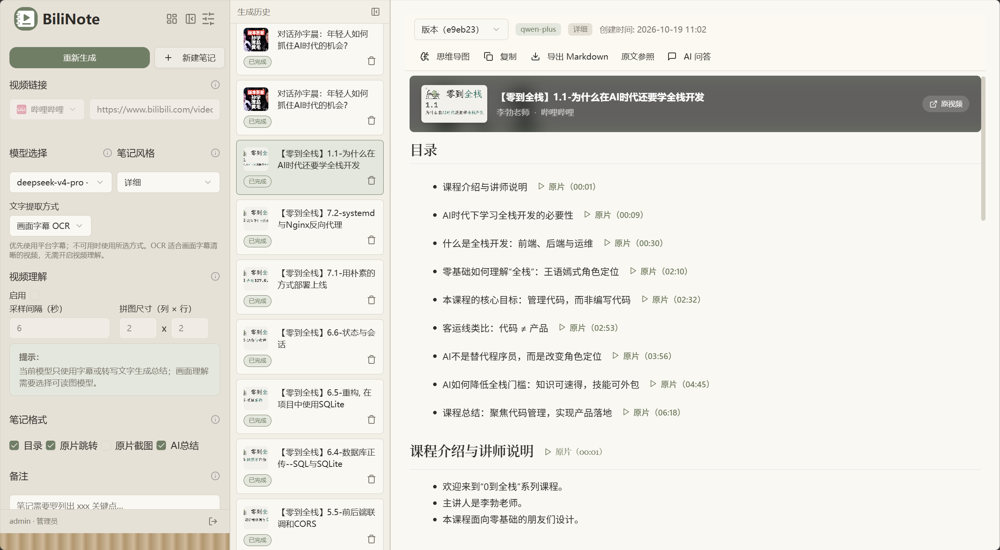
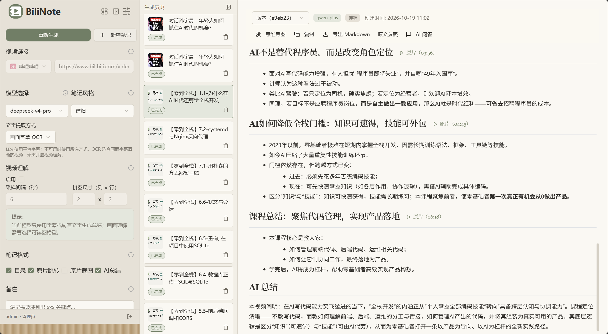
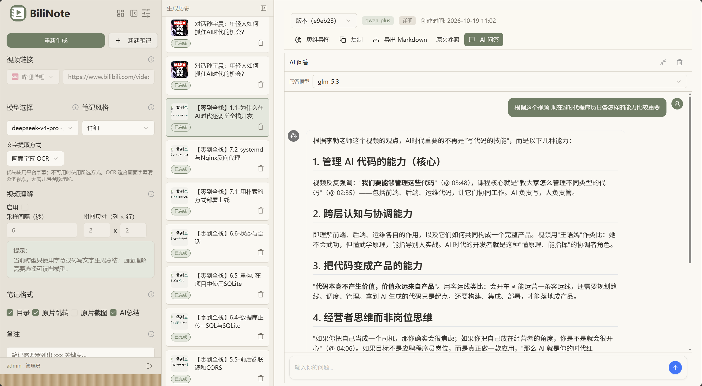
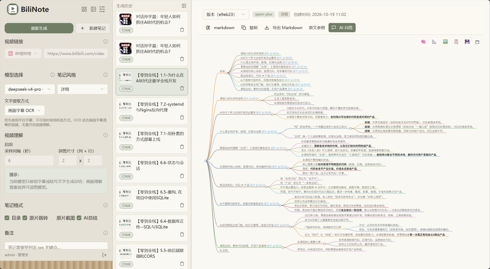
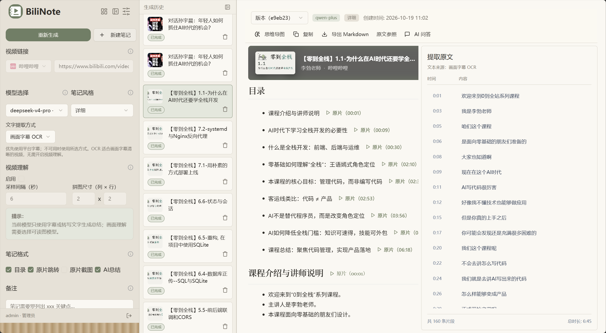
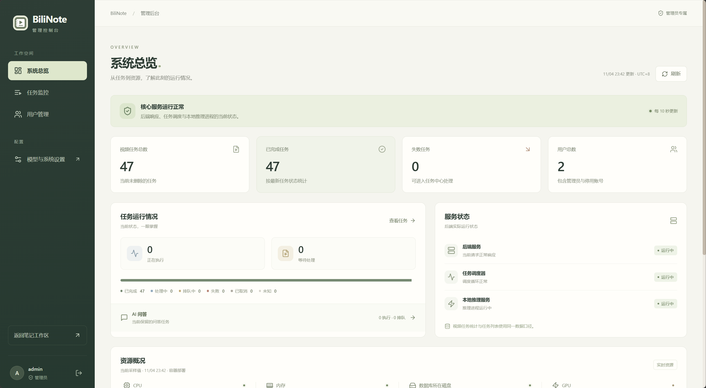
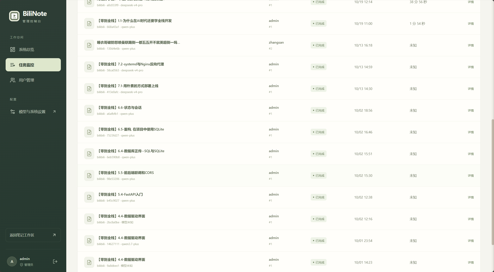
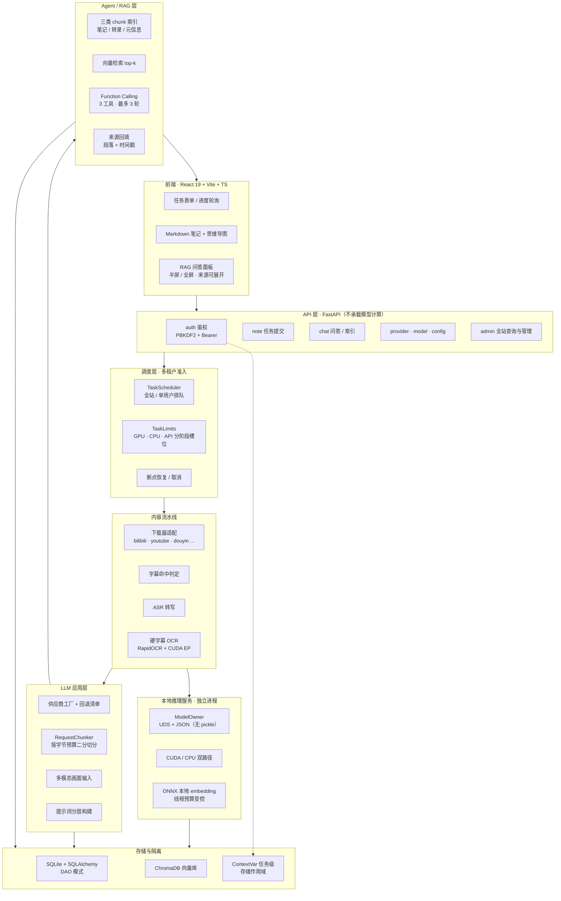
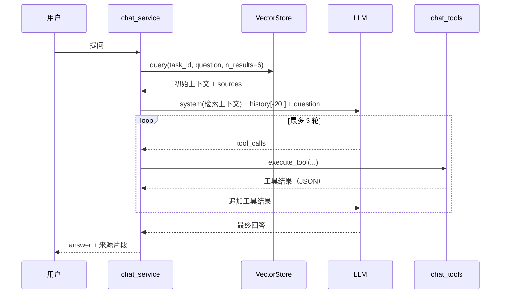

<p align="center">
  
</p>
<h1 align="center">BiliNote</h1>

<p align="center"><strong>从视频到可检索知识</strong></p>
<p align="center">结构化笔记 · 视频问答 · 思维导图 · 语音转写与字幕 OCR</p>

<p align="center">
  
  
  
  
  
  
  
  
</p>

<p align="center">
  <a href="#feature-preview">功能预览</a> ·
  <a href="#admin-console">管理后台</a> ·
  <a href="#architecture">技术架构</a> ·
  <a href="#quick-start">快速开始</a>
</p>

## ✨ 项目简介

BiliNote 是一款 **AI 视频笔记与问答工具**。粘贴视频链接或上传本地音视频，即可提取字幕或转写语音，生成带目录、要点和原片时间跳转的笔记；随后切换思维导图梳理结构，或围绕视频内容继续提问。

支持哔哩哔哩、YouTube、抖音、TikTok、快手与本地视频文件，提供 Web 工作区、浏览器扩展和桌面端。面向多人部署时，支持账号登录、用户数据隔离、任务排队和管理员后台。

<a id="feature-preview"></a>

## 📸 功能预览

下面用同一条课程视频，展示从生成笔记到回看原文、整理知识和继续提问的过程。所有截图均可点击查看原图。

### 1. 视频生成笔记，关键位置一键回看

在一个工作区中选择视频、模型与笔记风格，管理生成历史，阅读带章节目录和时间标记的笔记。点击「原片」链接，可以回到对应的视频位置。

[](docs/images/1.png)

<details>
<summary><strong>展开查看：笔记正文与 AI 总结</strong></summary>

目录下方按章节展开论点、例子和总结，便于阅读与复习；生成结果支持复制、导出 Markdown 和切换历史版本。

[](docs/images/2.png)

</details>

### 2. 围绕视频内容继续提问

看完笔记后，可以直接提出自己的问题。下图根据课程内容，追问 AI 时代程序员应具备的能力。问答结合笔记与转录检索，并可通过工具查询视频细节；问答模型可以独立选择。

[](docs/images/3.png)

### 3. 用思维导图梳理知识结构

同一份笔记可切换为思维导图，按章节与要点展开层级关系，适合快速回顾、整理课程脉络。导图支持缩放和 SVG 导出，节点中的原片链接保留时间定位。

[](docs/images/4.png)

### 4. 对照带时间轴的提取原文

优先复用平台字幕；字幕不可用时，按所选方式进行语音转写或画面字幕 OCR。「原文参照」显示文字来源、时间与文本片段，可与生成笔记对照阅读。

[](docs/images/5.png)

<a id="admin-console"></a>

## 🛠️ 管理后台

管理员登录后可进入 `/admin`，集中查看全站任务概况、服务运行状态，并管理用户账号。资源卡片提供当前可采集的 CPU、内存、GPU、显存与磁盘指标；任务与资源数据由后端读取并定期刷新。

[](docs/images/6.png)

<details>
<summary><strong>展开查看：跨用户任务列表</strong></summary>

任务监控支持查看视频笔记与问答任务，按用户、状态筛选，进入详情定位当前阶段和失败原因；管理员还可取消尚未执行的视频排队任务、重试失败的视频任务。

下面展示视频任务列表局部：不同用户的任务、使用模型、最新状态与已记录的耗时集中呈现，便于核对处理情况。旧任务缺少耗时记录时显示「未知」。

[](docs/images/7.png)

</details>

用户管理支持创建、启用、停用普通账号及重置密码。笔记、上传文件、聊天记录和向量索引按用户隔离；监控页展示运行信息，不新增跨用户正文读取权限。

<a id="architecture"></a>

## 🗺️ 技术路线总图

上述功能由视频处理流水线、检索与工具调用、独立推理进程以及多用户调度共同支撑。



> 实线为数据流，虚线为隔离约束。API 进程不直接持有模型句柄，所有推理经调度层转入独立推理服务。

## 🏗️ 核心实现

### 1. Agent 与 RAG 链路

问答不是"检索一次就回答"，而是**检索 + 工具调用双通道**：



**索引侧的三类 chunk**（`vector_store.py`）：

| chunk 类型 | 切分策略 | 关键元信息 |
| --- | --- | --- |
| `markdown` | 按 `##` / `###` 语义切分，短于 30 字符丢弃 | `section_title` |
| `transcript` | 15 段滑窗、3 段重叠，每段前置 `[N s]` 时间戳 | `start_time` / `end_time` |
| `meta` | 标题、UP 主、简介、标签合成单块 | 供"作者是谁"类问题命中 |

**工具设计**（`chat_tools.py`）——刻意区分"可精确查询"与"需全文"两类意图：

- `lookup_transcript`：支持 `start_time` / `end_time` 时间窗、`keyword` 关键词、`position=start|end` 快捷定位，避免模型为了找一句话把整份转录拉进上下文
- `get_video_info`：元信息
- `get_note_content`：完整笔记 Markdown

检索侧把 embedding 锁在 `CPUExecutionProvider`，`intra_op=2`、`inter_op=1`，使向量化算力落进 CPU 槽位预算，不与 GPU 推理争抢（`local_embeddings.py`）。

### 2. LLM 应用工程

- **上下文预算感知**：`RequestChunker` 按 UTF-8 字节估算消息体积，超限时优先按段落/图片边界切分；单段仍超限则对该段做**二分查找**，找到配置字节预算内可容纳的最大前缀。
- **多模态视频理解**：`VideoReader` 按固定间隔抽帧（`ThreadPoolExecutor` 并行，默认 2 线程）、相邻帧 MD5 去重，再拼成网格图（默认 2×2、单元 480×270、间隔 6 s）以压缩图片数量与 token 消耗，最后以 OpenAI `content` 数组（text + 多张 `image_url`）送入模型；`model_capabilities.py` 维护模型是否支持图片输入，纯文本模型自动退回 `string` content，避免 `invalid_request_error`。
- **供应商抽象**：工厂模式统一 OpenAI 兼容协议；针对 `/v1/models` 不可靠（部分网关不实现、key 无权限）的情况，内置供应商维护回退模型清单，改善模型选择与配置体验。
- **提示词分层**：`prompt.py` 模板 / `prompt_builder.py` 组装 / `timestamp_markers.py` 时间标记容错，风格切换不改调用方。

### 3. 推理与性能工程

**硬字幕 OCR（CPU / GPU 双路径）**——同一条视频实测：

| 阶段 | CPU | GPU (CUDA EP) | 加速比 |
| --- | --- | --- | --- |
| 字幕定位（含初始化） | 65.630 s | 10.942 s | ≈ 6.0× |
| 字幕提取 | 46.237 s | 7.427 s | ≈ 6.2× |
| **合计** | **111.867 s** | **18.369 s** | **≈ 6.1×** |

以上为记录中的单视频、同硬件对照结果；实际耗时随素材、模型与硬件而变化。

字幕布局学习、空缺复查、连续区域判定、未变化字幕带的结果复用，共同减少无效推理量。详见 [OCR 实现与配置说明](backend/OCR.md) 与 [GPU 验证记录](backend/OCR_GPU_VALIDATION.md)。

**推理服务隔离**（`inference_runtime.py`）：

- 模型句柄只存在于单个 ModelOwner 进程，API 进程通过 Unix Domain Socket 传 JSON，**不使用 pickle**（避免反序列化面）
- 带 stall timeout 与一次重连重试；超时时**先停 ModelOwner 再释放 GPU 槽位**，避免下一个任务拿到脏显存
- 串行 accept 保证 ASR 不会自我并发，因此 `TASK_GPU_SLOTS` 默认硬约束为 1，多槽位需显式开关放行

**资源闸门**（`task_limits.py` / `task_resources.py`）：

| 维度 | 默认值 | 依据 |
| --- | --- | --- |
| 全站并发 | 6 | 短素材吞吐收益拐点 |
| 单用户并发 / 排队 | 1 / 3 | 防止单用户挤占 |
| 全站排队上限 | 20 | 内存与磁盘缓冲 |
| GPU 槽位 | 1 | 实测并发 2/3/4 反而更慢（显存驻留与换入换出） |
| CPU 密集槽位 | 2 | 解码、OCR 预处理 |
| 模型 API 槽位 | 2 | 供应商限流友好 |

每个参数都有对应的压测记录与复现命令，见 [并发压测记录](backend/CONCURRENCY_BENCHMARK.md)。

### 4. 多租户与数据隔离

- 密码 PBKDF2-SHA256（60 万次迭代）存储，Bearer token 鉴权，登录接口按 IP 限流
- 笔记、上传文件、会话历史、向量索引按 `user_id` 分区；`storage_scope.py` 用 ContextVar 在任务上下文内隐式携带作用域，避免逐层透传
- 旧版单用户数据在升级时自动归入管理员账号（`legacy_migration.py`）
- `/admin` 后台的全站统计、任务操作、资源监控，以及供应商、转写器与用户配置均要求管理员权限；普通用户的业务接口继续校验数据归属

### 5. 技术栈

**后端**（Python 3.11 + FastAPI，端口 8483）

| 目录 | 职责 |
| --- | --- |
| `app/routers/` | `note` 任务、`auth` 登录、`chat` RAG 问答、`admin` 管理后台、`provider` / `model`、`config`、`history`、`files` |
| `app/services/` | `note.py` 流水线编排；`task_scheduler` / `task_limits` / `task_resources` 调度；`vector_store` 检索；`chat_service` + `chat_tools` Agent 循环；`inference_runtime` 推理服务；`auth` / `storage_scope` 隔离 |
| `app/ocr/` | 硬字幕 OCR：引擎封装、布局学习、时序合并、字幕质量判定、CUDA 运行时 |
| `app/gpt/` | 供应商工厂、提示词构建、`RequestChunker` 分块、多模态消息组装 |
| `app/downloaders/` · `app/transcriber/` | 平台适配器与转写引擎（上游基线） |
| `app/db/` | SQLite + SQLAlchemy，DAO 模式 |

**前端**（React 19 + Vite + TypeScript，开发端口 3015）

- `pages/HomePage/` —— 主工作区：任务表单、Markdown 预览、思维导图、`ChatPanel`（基于 `@ant-design/x` 的半屏 / 全屏问答，含引用来源展开与时间段展示）
- `pages/Admin/` —— 管理后台：系统总览、资源卡片、全站任务监控与用户管理
- `pages/SettingPage/` —— 供应商、转写器、下载、提示词、系统监控、用户管理
- `pages/Login/`、`pages/Onboarding/` —— 登录与首启引导
- `store/` —— Zustand：`taskStore` / `authStore` / `modelStore` / `providerStore` / `configStore` / `chatStore`
- 设计语言：Tailwind v4 + Radix UI + antd / `@ant-design/x`，主色 sage 绿 `#6e7f64`，明暗双主题

**其它**：`BillNote_extension/` 浏览器扩展（Vue 3 + MV3）；`BillNote_frontend/src-tauri/` 桌面端（Tauri 2）。

## 🔧 能力清单

| 分组 | 能力 |
| --- | --- |
| **Agent / RAG** | 向量检索 + Function Calling 双通道问答；三类 chunk 索引；来源与时间戳回填 |
| **LLM 应用** | 字节预算分块；多模态画面输入与能力判定；供应商回退清单；提示词分层 |
| **推理工程** | OCR CPU/GPU 双路径（≈6.1×）；单 ModelOwner 进程隔离；UDS + JSON 协议 |
| **调度与资源** | 全站 / 单用户 / GPU / CPU / API 五级准入；任务取消与断点恢复 |
| **多租户** | PBKDF2 鉴权、任务级存储作用域、向量库分区、旧数据迁移 |
| **管理后台** | 全站任务与服务状态、资源指标、用户管理、视频排队取消与失败重试 |
| **平台能力**（上游基线） | 六平台下载适配、五种转写引擎、字幕复用、截图与思维导图 |

## 📦 桌面版下载

桌面客户端（Windows / macOS）可在 [Releases](https://github.com/wlj666666/bilinote/releases) 页面下载。

> Windows 用户请注意：请勿在含中文的路径下运行。

<a id="quick-start"></a>

## 🚀 快速开始

### 方式一：Docker 部署（推荐）

确保已安装 Docker（含 Compose v2，即 `docker compose` 子命令），直接拉取预构建镜像运行：

```bash
docker pull ghcr.io/wlj666666/bilinote:latest

docker run -d -p 80:80 \
  -v bilinote-data:/app/backend/data \
  -v bilinote-config:/app/backend/config \
  -v bilinote-static:/app/backend/static \
  -v bilinote-uploads:/app/backend/uploads \
  -v bilinote-vector-db:/app/backend/vector_db \
  -v bilinote-models:/app/backend/models \
  --name bilinote \
  ghcr.io/wlj666666/bilinote:latest
```

六个卷分别持久化：

| 卷 | 容器内路径 | 内容 |
| --- | --- | --- |
| `bilinote-data` | `/app/backend/data` | SQLite 数据库（含 LLM 供应商配置、笔记历史）+ 生成的笔记 + 任务运行时缓存 |
| `bilinote-config` | `/app/backend/config` | 平台 Cookie、转写器运行时设置、任务超时覆盖 |
| `bilinote-static` | `/app/backend/static` | 笔记引用的视频截图 |
| `bilinote-uploads` | `/app/backend/uploads` | 用户上传的本地视频 |
| `bilinote-vector-db` | `/app/backend/vector_db` | RAG 问答的向量索引（**不挂会每次重建**） |
| `bilinote-models` | `/app/backend/models` | Whisper 模型缓存（可选，避免每次重新下载） |

这样 `docker pull` 升级新镜像、删旧容器重建后，配置和历史都不会丢。

> ⚠️ **不要**用 `-v 卷名:/app/backend` 挂整个后端目录——命名卷会用首次启动时的镜像内容固化，之后 `docker pull` 升级也会被旧代码盖住，导致「升级不生效」。只挂上面这些数据子目录即可。

#### 🔑 首次部署必须创建管理员账号

**这一步不能跳过。** 新版加入了登录与多用户隔离：模型供应商、转写器配置、系统监控等页面都要求**管理员**权限，而前端注册接口只能创建**普通用户**。管理员只能通过命令行创建：

```bash
# 单镜像（上面的 docker run 方式）
docker exec -it bilinote python scripts/manage_users.py init-admin admin

# docker compose 方式
docker compose exec backend python scripts/manage_users.py init-admin admin
```

命令会交互式要求输入密码（**12–128 字符**，输入时不回显，需输入两次）。

完成后访问 `http://localhost`，用该账号登录即可进入「设置」页配置模型供应商。

其它账号管理命令：

```bash
docker exec -it bilinote python scripts/manage_users.py create-user alice   # 创建普通用户
docker exec -it bilinote python scripts/manage_users.py reset-password admin # 重置密码
```

> 普通用户账号也可以由管理员在前端「用户管理」页创建，无需进容器。

#### 管理员后台

管理员登录后，可点击首页的「管理后台」入口，或直接访问 `/admin`。
后台提供系统总览、视频/问答任务监控、CPU/内存/GPU/磁盘资源卡片和用户管理；支持取消视频排队任务、重试失败任务、创建及启停用户和重置密码。
任务统计来自当前未删除任务的最新状态，问答展示后端当前保留的任务记录。资源无法读取时显示未知或不可用。
已有部署更新后需重启后端并重新构建前端；后端会自动补齐旧任务元数据。
详细范围见[核心需求](docs/管理员后台需求文档.md)，验证结果见[验证记录](docs/管理员后台验证记录.md)。

访问：`http://localhost`

也可以使用 docker compose 本地构建：

```bash
cp .env.example .env            # 第一次部署务必先创建 .env
bash deploy.sh cpu
docker compose exec backend python scripts/manage_users.py init-admin admin

# GPU 加速部署（需要 NVIDIA GPU + NVIDIA Container Toolkit，详见下方「CUDA / GPU 加速」）
bash deploy.sh gpu
```

Compose 部署建议使用 `bash deploy.sh gpu`（CPU 用 `bash deploy.sh cpu`）：先构建镜像、
准备并验证本地 Embedding 模型，成功后才重建服务。首次准备模型需要联网，后续复用
`backend/models/chroma/onnx_models/all-MiniLM-L6-v2/onnx/` 的六个模型文件。
Docker 后端默认禁止请求内下载，模型缺失或损坏会在启动时明确报错。
已有预置模型时，部署与容器重建均不需要下载模型。

Compose 的后端代码以宿主机 `backend/`（容器 `/legacy`）为准；修改 Python 代码后
重启 backend，修改依赖后运行部署脚本。网页修改需要重新构建 frontend。
启动日志会打印实际加载的 Embedding 模块及模型路径，可据此核对部署版本。

网页 AI 问答通过 `/api/chat/jobs` 提交任务并查询结果，每条 HTTP 请求都很短，
慢模型不会使同一条公网隧道请求持续等待。答案与聊天历史一起持久化，刷新或重新打开
问答可继续查看；服务重启时未完成的问题会标记失败，并提示重新提问。
默认每用户同时处理一个问题，全站最多 20 个待处理问题、2 个问答 worker，
每个问题处理预算为 180 秒，可通过 `.env.example` 中的 `CHAT_*` 配置调整。
当前 worker 调度适用于单个后端进程；不要对同一数据库启动多个 API 副本。

公网访问时，让隧道指向 Docker 的 Nginx 入口（默认 `http://127.0.0.1:3015`），
前端 API 保持同源 `/api`。`trycloudflare.com` 是临时地址，重启隧道可能变化；
长期服务应配置自己的域名和固定隧道。

> 部署脚本要求 Docker Compose v2；旧版 `docker-compose` v1 请先升级。

#### Docker 部署常见问题（FAQ）

社区反馈最集中的几个坑，遇到先按下面排查：

**0. 国内拉不到 docker.io（build 阶段报 `dial tcp ... i/o timeout`）**

`docker compose build` 拉 `python:3.11-slim` / `node:20-alpine` / `nginx:1.25-alpine` 时连 `auth.docker.io` 超时。三种解法，按推荐顺序：

- **方法 A：直接用预构建镜像（最省事）**——不要本地 build，跳到上面的 `docker pull ghcr.io/wlj666666/bilinote:latest` 路径，ghcr.io 在国内通常比 docker.io 顺。
- **方法 B：配置 Docker daemon 镜像加速器**——编辑 `/etc/docker/daemon.json`（Docker Desktop 在设置 → Docker Engine 里改），加：
  ```json
  {
    "registry-mirrors": ["https://docker.m.daocloud.io", "https://docker.1panel.live"]
  }
  ```
  然后重启 Docker Desktop / `sudo systemctl restart docker`。这是一劳永逸的做法。
- **方法 C：临时切换 base image 镜像源**——本项目所有 Dockerfile 都暴露了 `BASE_REGISTRY` build-arg：
  ```bash
  BASE_REGISTRY=docker.m.daocloud.io docker compose build
  docker compose up -d
  ```
  或永久写到 `.env`：`echo 'BASE_REGISTRY=docker.m.daocloud.io' >> .env`。

注意：Chinese 公共 docker 镜像源时常被关停，2025-2026 之间可用的列表会变；如果 `docker.m.daocloud.io` 不通，搜一下"Docker 镜像加速 可用"找最新可用源即可。

**1. 容器一直 restart / unhealthy**

先看后端日志：
```bash
docker logs -f bilinote-backend
```
后端启动会按顺序打印 `[startup 1/5] ... [startup 5/5] 启动完成`。若日志卡在某一步或出现 `[startup FAILED]`，就是那一步的问题，常见：
- **卡在 `[startup 3/5]`**：转写器配置读不到。检查 `.env` 里 `TRANSCRIBER_TYPE` 是否写错，`mlx-whisper` 只能在 Apple Silicon 用，Linux/Docker 请用 `fast-whisper` 或 `groq`。
- **首次跑视频时容器被 kill**：whisper 模型下载触发 OOM。先把 `.env` 里 `WHISPER_MODEL_SIZE` 改成 `tiny`，跑通后再去前端「音频转写配置」里逐档升。同时注意 `TASK_MAX_WORKERS`（默认 6）与 `mem_limit` 的匹配关系。

健康检查说明：compose 的 healthcheck 打的是公开端点 `/api/sys_check`（返回 200 即健康）。**不要**改成 `/api/sys_health`——后者需要管理员 Bearer token，容器内匿名 curl 会恒 401，导致容器永远 `unhealthy`、nginx 永远不启动。

**2. 改了 `.env` 没生效**

区分两类变量：
- `VITE_*` 是**构建时**变量（会被烘进前端 JS bundle）。不过 Docker 部署下前端固定走 nginx 的 `/api` 反代，**不需要设置 `VITE_API_BASE_URL`**；改了它也不会生效，除非重新 build 前端。
- 其他后端变量（`TRANSCRIBER_TYPE`、`WHISPER_MODEL_SIZE`、`FFMPEG_BIN_PATH`、`OCR_DEVICE`、`TASK_*` 等）是**运行时**变量，改完 `docker compose up -d` 即可。

注意：**LLM API key 不要写 `.env`**，从前端「模型供应商」页面录入，会保存到 SQLite 数据库并持久化。

**3. 数据存在哪？删容器会丢吗？**

`docker compose` 把宿主机的 `./backend` 绑挂到容器的 `/legacy`，后端入口和 `PYTHONPATH` 都指向该目录。
升级 Compose 部署时需要同时更新宿主机代码；单镜像 `docker run` 部署仍使用镜像内代码。
以下内容都在宿主机 `./backend/` 下、删容器不会丢：

- `./backend/bili_note.db` —— SQLite 库（含账号、LLM 供应商配置、笔记历史）
- `./backend/config/` —— Cookie、转写器设置、任务超时覆盖
- `./backend/static/` —— 视频截图
- `./backend/uploads/` —— 上传的本地视频
- `./backend/vector_db/` —— RAG 向量索引
- `./backend/data/` —— 任务运行时缓存、源文件缓存、笔记输出
- `./backend/models/` —— Whisper 与 AI 问答 Embedding 模型缓存

要彻底重置就 `docker compose down && rm -rf backend/bili_note.db backend/config backend/vector_db`。

> 单镜像（`docker run`）方式请对照上面六个命名卷的表格。

**4. 前端打开是空白页 / 报 502**

通常是 nginx 起来了但 backend 还没 healthy。`docker ps` 看 backend 容器 STATUS 是不是 `(healthy)`；若长期 `(unhealthy)`，按问题 1 排查后端日志。

**5. 不要用 `restart: on-failure:N`**

如果你 fork 后改过 compose 文件、把 restart 策略改成了 `on-failure:3`：任何 3 次连续崩溃都会让容器永远不再启动，之后改 `.env` 也没用。本项目自带的 compose 已经统一用 `unless-stopped`。

**6. 上传大文件失败 / 长任务返回 504**

nginx 默认 `proxy_read_timeout` 是 60 秒，长 LLM 调用会被掐断。本项目的 `nginx/default.conf` 与 `nginx/standalone.conf` 已配置 `proxy_read_timeout 300s` 和 `proxy_request_buffering off`（大文件直通后端，不先落盘）。若你自建反代，请同步这两项。

**7. 多人同时登录时第 11 个人报 429**

后端登录限流按客户端 IP 计数（10 次/分钟）。若反代没透传真实 IP，所有用户会被算成同一个来源。本项目 nginx 已设置 `X-Forwarded-For`，compose 里也设了 `FORWARDED_ALLOW_IPS=*`（仅 Docker 内网可达）。若你把后端直接暴露到公网，请把 `FORWARDED_ALLOW_IPS` 置空，否则外部可伪造该头绕过限流。

### 方式二：源码部署

#### 1. 克隆仓库

```bash
git clone https://github.com/wlj666666/bilinote.git
cd bilinote
mv .env.example .env
```

#### 2. 启动后端（FastAPI）

```bash
cd backend
pip install -r requirements.txt
pip install -r requirements-ocr.txt   # 硬字幕 OCR 依赖；不做 OCR 可跳过
python main.py
```

> 想用 GPU 加速（转写 + OCR），Linux/WSL 上额外装：
> ```bash
> pip install -r requirements-gpu.txt      # faster-whisper 的 CUDA 运行时
> pip uninstall -y onnxruntime
> pip install -r requirements-ocr-gpu.txt  # OCR 的 CUDA 运行时
> ```
> 然后用 `./start-gpu.sh` 启动（会自动注入 `LD_LIBRARY_PATH` 并设 `OCR_DEVICE=cuda`），不要直接 `python main.py`。

首次启动后同样需要创建管理员账号（模型供应商等页面要求管理员权限）：

```bash
python scripts/manage_users.py init-admin admin
```

#### 3. 启动前端（Vite + React）

```bash
cd BillNote_frontend
pnpm install
pnpm dev
```

访问：`http://localhost:3015`

## ⚙️ 依赖说明

### 🎬 FFmpeg
本项目依赖 ffmpeg 用于音频处理与转码，源码部署时必须安装：
```bash
# Mac (brew)
brew install ffmpeg

# Ubuntu / Debian
sudo apt install ffmpeg

# Windows
# 请从官网下载安装：https://ffmpeg.org/download.html
```
> ⚠️ 若系统无法识别 ffmpeg，请将其加入系统环境变量 PATH
>
> Docker 部署已内置 FFmpeg，无需额外安装。

### 🚀 CUDA / GPU 加速（可选）

本地 **Faster Whisper** 转写与**硬字幕 OCR** 可用 NVIDIA GPU 加速（在线引擎 Groq / 必剪 / 快手 与 GPU 无关）。仓库已自带 GPU 镜像与编排，**无需改代码**。

**1. 宿主机前提**

- NVIDIA 显卡 + 较新驱动（需支持 CUDA 12.x），宿主机 `nvidia-smi` 能正常输出；
- 安装 [NVIDIA Container Toolkit](https://docs.nvidia.com/datacenter/cloud-native/container-toolkit/latest/install-guide.html)（最易漏的一步，没它 Docker 进不去 GPU）。装完验证：
  ```bash
  # 用一个任意带 CUDA 的镜像测透传；也可以直接用本项目的 GPU 镜像
  docker run --rm --gpus all python:3.11-slim nvidia-smi
  ```
  能列出显卡即 OK。

**2. 切换到 GPU 编排**（在源码目录里）

CPU 与 GPU 两套 compose 用了相同的容器名，先停掉当前栈再起 GPU 栈：

```bash
docker compose down                                       # 停掉当前（CPU）栈
docker compose -f docker-compose.gpu.yml up --build -d    # 用 GPU 栈重建
```

- GPU 栈用 `backend/Dockerfile.gpu`：基础镜像与 CPU 栈**完全相同**（`python:3.11-slim`），因此 Python 版本（3.11）与 CPU 镜像、CI 保持一致，不会出现「只在 GPU 路径上踩版本差异」的问题。
- CUDA 运行时（cuBLAS / cuDNN / cuFFT / cuRAND / cuda_runtime）由 `requirements-gpu.txt` / `requirements-ocr-gpu.txt` 里的 pip wheel 提供，**不需要 `nvidia/cuda` 基础镜像**；运行时真正需要的驱动 `libcuda.so` 由 NVIDIA Container Toolkit 注入。
- 这些 wheel 把 `.so` 装在 `site-packages/nvidia/*/lib`，该路径不在动态链接器搜索范围内。镜像构建时会自动把这些目录写进 `/etc/ld.so.conf.d/` 并执行 `ldconfig`——**少了这一步，设置页会显示「CUDA 不可用」**，尽管显卡完全正常。
- **数据不丢**：两套 compose 都绑挂 `./backend`，数据库 / 配置 / 已下载模型都保留。
- 首次构建较大较慢（要下载 `onnxruntime-gpu` 及若干 nvidia CUDA wheel，约 2–3 GB），最终镜像约 8 GB，耐心等。

**3. 启用并确认**

- 「设置 → 音频转写配置」转写引擎选 **Faster Whisper（本地）**，GPU 下可放心选大模型（如 `large-v3`）。
- 硬字幕 OCR 默认 `OCR_DEVICE=cuda`（GPU compose 已设）；设为 `cuda` 但缺少 GPU 依赖时会**直接报错，不会静默回退 CPU**。
- 确认真的走了 GPU，三种方式任选：
  ```bash
  # a) 设置页「系统监控」看 CUDA 状态
  # b) 后端日志
  docker logs bilinote-backend | grep -i cuda
  # c) 直接问引擎（最可靠）
  docker compose exec backend python -c "import ctranslate2; print(ctranslate2.get_cuda_device_count())"
  docker compose exec backend python -c "import onnxruntime as o; print(o.get_available_providers())"
  ```
  预期：第一条输出 `1`，第二条包含 `CUDAExecutionProvider`。转写时宿主机 `nvidia-smi` 也能看到 python 进程占显存。

**国内镜像**：GPU compose 支持 `BASE_REGISTRY` / `APT_MIRROR` / `PIP_INDEX` 这几个 build-arg。与 CPU 栈一样，`BASE_REGISTRY` 只需能拉到 `python:3.11-slim`，**不要求镜像源支持 `nvidia/cuda` 命名空间**。

**起来了但没走 GPU？** 依次排查：

1. 宿主机 `nvidia-smi` 是否正常；
2. NVIDIA Container Toolkit 是否装好（上面 `--gpus all` 测试是否通过）；
3. 容器内 `ldconfig -p | grep cublas` 是否有输出——没有说明 `ldconfig` 步骤没生效；
4. `docker logs bilinote-backend` 是否有 CUDA / cuDNN 报错（宿主机驱动需支持 CUDA 12.x）。

`fast-whisper` 本身的 GPU 依赖说明可参考：[faster-whisper 项目](https://github.com/SYSTRAN/faster-whisper#requirements)

## 🧠 路线图

- [x] 支持抖音、TikTok 及快手等视频平台
- [x] 前端可切换 AI 模型与语音转文字模型
- [x] AI 摘要风格自定义（学术风、口语风、重点提取等）
- [x] 基于 RAG + Function Calling 的笔记内容 AI 问答
- [x] 管理员 / 多用户登录与数据隔离
- [x] 硬字幕 OCR 提取（CPU / GPU 双路径）
- [x] 多用户任务调度与资源限额
- [x] 管理后台：系统总览、任务与资源监控、用户管理
- [ ] 检索质量评估：召回率 / 命中率基准集与 A/B 对比
- [ ] 笔记导出为 PDF / Word / Notion（当前仅支持 Markdown 与思维导图 SVG）

## 🔎 代码参考

- `抖音下载功能` 部分代码参考引用自 [Evil0ctal/Douyin_TikTok_Download_API](https://github.com/Evil0ctal/Douyin_TikTok_Download_API)

## 🙋 贡献范围说明

本项目 fork 自 [JefferyHcool/BiliNote](https://github.com/JefferyHcool/BiliNote)（MIT），并在其上做了大量重构与新增。为避免歧义，在此明确划分：

**上游基线**（继承，非本人实现）

- 平台下载适配器（bilibili / youtube / douyin / kuaishou / local）与抖音下载的第三方实现
- 语音转写引擎接入（fast-whisper / mlx-whisper / groq / bcut / kuaishou）
- 前端视觉设计语言、思维导图渲染、Tauri 桌面打包、浏览器扩展

**本项目新增与重构**

| 模块 | 内容 |
| --- | --- |
| Agent / RAG | `chat_service.py`、`chat_tools.py`、`vector_store.py`、`local_embeddings.py` —— 检索 + Function Calling 闭环、三类 chunk 索引、来源回填 |
| LLM 应用 | `request_chunker.py`（字节预算二分切分）、`model_capabilities.py`（多模态能力判定）、`model_fallback.py`（供应商回退清单）、`universal_gpt.py` 多模态消息组装 |
| 推理工程 | `app/ocr/` 全套（布局学习、空缺复查、结果复用、CUDA 运行时）、`inference_runtime.py`（单 ModelOwner + UDS）、`profiling.py` 与压测脚本 |
| 调度与资源 | `task_scheduler.py`、`task_limits.py`、`task_resources.py`、`task_recovery.py` —— 五级准入、取消、断点恢复 |
| 多租户 | `auth.py`、`storage_scope.py`、`legacy_migration.py`、`user_data.py` —— 鉴权、任务级隔离、旧数据迁移 |
| 前端问答 | `ChatPanel.tsx` —— 半屏 / 全屏问答视图、引用来源展开、时间段落展示 |
| 管理后台 | `pages/Admin/`、`routers/admin.py`、`services/admin.py`、`admin_resources.py` —— 全站查询、资源采样、任务处置与用户管理 |

## 📜 License

本项目基于 [JefferyHcool/BiliNote](https://github.com/JefferyHcool/BiliNote) 二次开发，遵循 MIT License。原始版权声明：

```
MIT License

Copyright (c) 2024 Jeffery Huang
```

## 📚 相关文档

- [任务调度说明](backend/TASK_SCHEDULING.md)：多用户部署的并发、排队、取消和中断恢复规则。默认全站执行 6 个、每用户执行 1 个；GPU 推理 1 个、CPU 密集阶段 2 个、模型总结请求 2 个。
- [并发压测记录及参数选择依据](backend/CONCURRENCY_BENCHMARK.md)：参数选择依据、GPU 并发 1/2/3/4 对比、显存驻留实验和复现命令。
- [管理员后台核心需求](docs/管理员后台需求文档.md)：总览、任务监控、资源与用户管理的范围及口径。
- [管理员后台验证记录](docs/管理员后台验证记录.md)：真实数据来源、权限与任务操作回归、浏览器联调及验证边界。
- [OCR 实现与配置说明](backend/OCR.md)：字幕提取流程、设备选择与运行参数。
- [OCR GPU 加速验证](backend/OCR_GPU_VALIDATION.md)：CPU / GPU 同视频对照数据。
- [OCR 验证记录](backend/OCR_VALIDATION.md)：合成素材、真实视频测试及验证边界。
- [登录会话与权限校验实现](backend/app/services/auth.py)：密码校验、登录会话与管理员鉴权。
- [旧历史迁移实现](backend/app/services/legacy_migration.py)：数据归属迁移与数据库备份。
