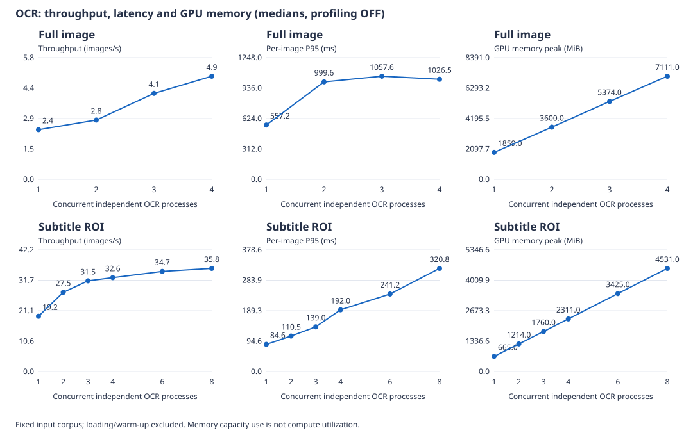
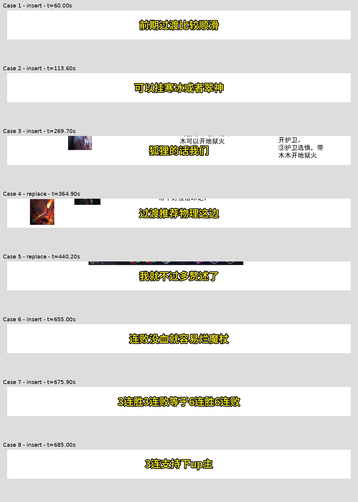

# OCR 推理与并发 profiling 报告（2026-10-30）

## 直接结论

1. 本轮没有复现“OCR 提高并发导致整体吞吐持续下降”。全画面并发1→4，吞吐从 2.38 提高到 4.94 图/秒；但单图 P95 从 557.2 增至 1026.5 ms。**任务整体更快完成与单个请求响应变慢可以同时发生。**
2. 字幕ROI并发1→8，吞吐约 19.19→35.80 图/秒，P95约 84.6→320.8 ms。并发4以后收益明显变小，继续占更多显存并不带来等比例加速。
3. **同一个完整692.8秒视频**，默认OCR流程耗时 301.095s，关闭方向分类并启用TF32为 262.228s，本次耗时减少 12.9%。两组均通过原有质量门禁。整份文字及片段时间/文字三元组不完全一致，字符序列相似度 98.8595%。该数值只用于定位差异，不是准确率，不能据此宣称无损。
4. 识别batch从6增至16没有收益：更慢、显存更高，且部分画面ROI文字变化。真实张量记录显示，同样368个文字框，批次减少，但总输入元素增加约 48.2%，与批内按最大宽度padding的实现吻合。
5. 发现配置实际未生效的情况：RapidOCR 3.9.2 的 max 模式会动态选择尺寸档位，覆盖配置的检测边长。诊断中真正强制1280/960会提速，但输出发生变化，不直接推广为默认优化。

## 1. 环境、输入与实验控制

- GPU：RTX 5060 Laptop，8151 MiB，驱动573.24，WSL2；CPU可见逻辑数32。
- ONNX Runtime GPU 1.21.0，RapidOCR 3.9.2，cuBLAS 12.8.4.1，cuDNN 9.8.0.87。
- 模型：PP-OCRv6 det_small、PP-OCRv6 rec_small、方向分类模型。模型哈希在[环境归档](benchmark_records/2026-10-30-ocr-profiling/environment-final.json)。
- 视频：`BV19mYE6ZEM8.mp4`，1920×1080，692.8秒，SHA-256 `9d94b595eea5aca53f15b26cad4f4de434a0153c7e7b650eed286361e7caec03`。
- 微基准：在全片均匀取96个真实画面，保存RGB数组和哈希；不通过循环复制短片构造长素材。固定ROI为 `[0.10,0.79,0.90,0.92]`，与生产自动定位ROI并不完全相同。
- 测试并发采用独立进程、每进程一套OCR引擎。不是共享线程安全session，也不是跨请求动态batch。
- 稳态耗时排除加载模型、预热、读图；总图片数固定。并发轮次逆序交替，主要档位各重复3次，调参各2次。优化与基线使用相同模型和输入。
- 性能比较关闭profiling；少量图片另行采集trace。显存为GPU总已用显存采样峰值，包含桌面等基础占用，不是精确的单模型峰值。
- 独立实验绕过生产资源门禁；没有调整正式调度器的GPU=1策略，没有调用付费API。
- 有效图片实验54组：46组关闭profiling的GPU性能对照、7组GPU profiling、1组CPU冒烟；另有3组完整视频及9处同像素方向分类复查。排除的3组另有明确记录。

## 2. 并发、吞吐、延迟、显存

### 全画面

| 并发 | 重复次数 | 96图耗时中位数(s) | 吞吐(图/s) | 单图P95(ms) | GPU总显存峰值(MiB) |
|---:|---:|---:|---:|---:|---:|
| 1 | 3 | 40.354 | 2.38 | 557.2 | 1859 |
| 2 | 3 | 33.814 | 2.84 | 999.6 | 3600 |
| 3 | 3 | 23.327 | 4.12 | 1057.6 | 5374 |
| 4 | 3 | 19.443 | 4.94 | 1026.5 | 7111 |

### 已知字幕ROI

| 并发 | 重复次数 | 96图耗时中位数(s) | 吞吐(图/s) | 单图P95(ms) | GPU总显存峰值(MiB) |
|---:|---:|---:|---:|---:|---:|
| 1 | 3 | 5.003 | 19.19 | 84.6 | 665 |
| 2 | 3 | 3.491 | 27.50 | 110.5 | 1214 |
| 3 | 3 | 3.050 | 31.48 | 139.0 | 1760 |
| 4 | 3 | 2.945 | 32.60 | 192.0 | 2311 |
| 6 | 3 | 2.763 | 34.75 | 241.2 | 3425 |
| 8 | 3 | 2.681 | 35.80 | 320.8 | 4531 |

各并发档位相对相同输入的串行基线，ROI内文字逐图一致率均100%；基线全画面96图有92图在ROI中包含文字。这个指标是**输出一致性**，不是人工标注准确率。

### 怎样回答“为什么加并发还慢”

- 若“慢”指单个OCR请求：本次确实观察到延迟上升。多个独立进程共同推进，吞吐可以提高，同时每个进程在模型调用里花更久。比如全画面并发1→2，检测session.run每图平均约91.6→191.3ms，识别session.run约182.6→334.5ms。
- 若“慢”指处理同样一组图片的总时间：本次有效正式对照没有证实下降。不能沿用Whisper的结论，也不能把微小且在重复波动范围内的差异解释成必然退化。
- 原始ROI trace的48图诊断中，并发4→8时总时间近似不变，而单图检测run时间约55.7→117.5ms。该组启用了profiling，仅作为执行路径和等待的佐证，不拿它替代96图关闭profiling的性能对照。
- 已排除重复下载、不同图片数量和模型加载计入稳态等混杂项。阶段记录把增加的宿主侧时间定位到了模型调用及相关处理路径。**这些记录仍不能严格区分GPU计算单元争用、显存带宽、CUDA上下文切换、同步等待或CPU提交开销各占多少。**
- 显存用量是容量占用；本轮ROI并发8仅约4.5GiB已用，吞吐也已接近平台。余下容量不等于相同比例的计算资源空闲。`nvidia-smi`利用率也不是理论算力利用率。

正式服务应按吞吐目标、延迟预算、显存余量选择候选档位。本轮ROI并发3/4后的收益较小，可以作为后续服务化实验候选；不能只把`TASK_GPU_SLOTS`改大，当前共享推理服务还限制该值为1，且需与Whisper混合负载、故障恢复和用户公平性一起验证。

### 与 2026-10-16 Whisper 压测是否矛盾

[多用户并发压测](CONCURRENCY_BENCHMARK.md)的结论是“GPU 并发1最快”，本轮OCR的结论是“吞吐随并发提高”。两者不构成同一参数上的对立结论，因为**并发单位不同**：

| 维度 | 2026-10-16 Whisper 压测 | 本轮 OCR profiling |
|---|---|---|
| 并发实现 | 同一个模型实例内`num_workers`（即CTranslate2 `inter_threads`），Python线程池并发调用`transcribe()` | N个独立进程，每进程一套OCR引擎和独立CUDA context |
| 共享资源 | 共享权重、共享CUDA context、共享解释器（GIL） | 只共享同一块GPU，不共享session |
| 输入与工作量 | 12次相同的30秒语音 | 96张固定画面（全画面／固定ROI） |
| 实测 | 并发1/2/3/4耗时38.84/78.66/89.26/92.36秒，显存2781→6165 MiB | 全画面2.38→4.94图/s，ROI 19.19→35.80图/s；单图P95同时上升 |

可以确认的差异只有测量条件本身。以下只是**未验证的候选解释**，本轮没有做对照实验：线程池共享一个CUDA context并受GIL影响；Whisper自回归解码以小kernel和较重的CPU侧采样为主；OCR检测/识别是大batch卷积，单图流程中还有可被其他进程填补的CPU预处理/后处理空隙。压测中并发1→2耗时接近翻倍（38.84→78.66秒），更像是串行化加额外开销，而不是“两个任务并行各慢一半”，但**没有重跑Whisper多进程对照**，不能据此宣称多进程Whisper也一定更慢。

正式服务保持`TASK_GPU_SLOTS=1`的理由与上面两个数字无关：

1. 两轮都不是混合负载实验。本轮OCR全程独占GPU，没有Whisper同时存在；压测的混合工作流固定GPU名额为1，没有比较名额2/3。
2. 当前`inference_runtime.serve()`的`accept()`是串行的，全后端只有一个`ModelOwner`持有Whisper。名额大于1不会让Whisper并行，只会允许OCR与Whisper、或OCR与OCR重叠，这两种组合未测。
3. 8 GiB卡上，Whisper约2.8 GiB，全画面OCR并发4峰值已达7111 MiB（超过本轮91%保护阈值的观察值），叠加后余量不足。
4. 本轮收益以**单图延迟上升**为代价（全画面P95 557→1027 ms，ROI 85→321 ms）。笔记生成是提交后等待结果的任务，应先定延迟预算，再决定是否接受这个交换。
5. `TaskLimits.from_env()`当前硬性要求该值为1，改动需同时调整推理服务生命周期和资源管理。

因此本轮结论的准确表述是：**“若将来把OCR做成可并发的服务形态，ROI并发3/4是值得先试的候选档位”**，不是“现在应把`TASK_GPU_SLOTS`改成3或4”。

## 3. ORT profiling 证据

来自同样12张真实全画面的baseline记录，包含3张预热画面的事件：

| 模型 | CUDA节点执行事件 | CPU节点执行事件 | CPU算子 |
|---|---:|---:|---|
| text_det | 2850 | 0 | 无 |
| text_cls | 13425 | 0 | 无 |
| text_rec | 13575 | 150 | Slice, Concat |

- 检测、分类、识别均实际记录到CUDA节点执行；识别中的少量CPU `Slice`、`Concat`事件不等于整个模型回退CPU。
- 宿主节点聚合中Conv耗时排在前列，但不能直接据此宣称GPU算力或带宽已饱和。
- `StageRecorder`提供业务阶段和session.run的宿主墙钟计时，`host-timeline.json`可查看跨进程阶段重叠；ORT原始文件包含每个节点和provider。
- ORT节点`dur`不是device kernel-only时间；多进程累计时间会重叠，不能相加当作总耗时；节点事件数不是算力占比。
- 本机未安装`nsys`、`ncu`，本次没有kernel级计数器证据。若需要继续定因：先用Nsight Systems看CPU/CUDA提交、传输、同步与GPU空隙；再对占时最大的kernel用Nsight Compute验证计算吞吐、内存吞吐与occupancy。没有把这些待验证原因写成已证实结论。

原始记录入口：[全画面trace](data/ocr_profile/2026-10-30/profiles-shapes/)、[ROI trace](data/ocr_profile/2026-10-30/profiles-roi-correct/)。

## 4. 单因素优化结果

| 配置（并发1） | 次数 | 96图耗时中位数(s) | 相对相同输入基线耗时变化 | ROI内文字逐图一致 |
|---|---:|---:|---:|---:|
| baseline | 3 | 40.354 | +0.0% | 100.0% |
| no-cls | 2 | 33.037 | -18.1% | 100.0% |
| tf32 | 2 | 35.704 | -11.5% | 100.0% |
| no-cls-tf32 | 2 | 29.942 | -25.8% | 100.0% |
| batch16 | 2 | 43.172 | +7.0% | 93.8% |
| det960 | 2 | 39.850 | -1.2% | 100.0% |
| det1280-effective | 2 | 26.888 | -33.4% | 76.0% |
| det960-effective | 2 | 21.754 | -46.1% | 79.2% |
| roi-no-cls | 2 | 4.562 | -8.8% | 97.9% |

`det960`是只修改配置、但被上游动态档位覆盖的对照；`*-effective`才真正改变输入尺寸。变化百分比负值表示耗时减少。ROI内文字一致率包括空文字帧，非空帧统计见机器可读汇总；不能把输出变化率直接当作错误率。

### batch=16 为什么反而更慢

对相同12图，检测结果送入识别的文字框总数均为368：

| 项目 | batch=6 | batch=16 |
|---|---:|---:|
| 实际识别run次数 | 66 | 26 |
| 识别输入张量累计元素 | 23012496 | 34102800 |
| 最大识别输入形状NCHW | [6, 3, 48, 1220] | [14, 3, 48, 1804] |
| 识别run累计宿主时间(s) | 1.454 | 1.757 |

RapidOCR先按文字框宽高比排序，再将一个batch内图片padding到该批最大宽度。
batch更大时，短文字框也可能被填充到更宽尺寸。此次调用次数下降约61%，但输入元素增加约48%，识别run时间增加，整体也变慢。
这解释了“减少调用次数不等于减少工作量”；具体kernel效率仍未测量。96图实验中6图的ROI文字发生变化，亦说明batch变化可能通过padding/尺寸影响结果，不能直接把16当作更优参数。

### 检测边长配置为何不生效

安装的RapidOCR 3.9.2 `TextDetector.get_preprocess()`在max模式中选择960/1500/2000档位，不使用配置的`limit_side_len`。
实际baseline全画面检测输入是`[1,3,1088,1920]`；显式强制1280后变成`[1,3,704,1280]`。
因此仅改参数时速度基本没变；真正降低尺寸后更快，但文字检测分组和输出也发生变化。
诊断开关只用于本次隔离验证，生产默认逻辑未自动替换。将来若修复此配置行为，应独立做多素材回归，尤其检查短字幕、小字、数字和否定词。

## 5. 完整视频验证

三组均对原始692.8秒视频全程处理，默认5fps，包含解码、粗定位、自动ROI、视觉复用、跨帧合并、局部复查和质量门禁。没有用固定ROI代替完整算法，没有调用ASR或LLM。每组一次，尚无完整视频重复试验的置信区间。

| 指标 | 默认 | 仅TF32 | no-cls + TF32 |
|---|---:|---:|---:|
| 冷启动总耗时(s) | 301.095 | 283.703 | 262.228 |
| 定位扫描(s) | 114.052 | 104.607 | 88.453 |
| 字幕提取(s) | 127.543 | 123.073 | 118.149 |
| 局部复查(s) | 58.430 | 55.140 | 54.796 |
| 字幕片段数 | 358 | 359 | 365 |
| 视觉复用帧数 | 2054 | 2054 | 2058 |
| 主提取阶段实际OCR帧数 | 1410 | 1410 | 1406 |
| 未解决空缺(s) | 0 | 0 | 0 |
| 质量门禁 | success | success | success |

本次冷启动总耗时减少 **12.9%**。整份文字及片段时间/文字三元组不完全一致，字符序列相似度 98.8595%。该数值只用于定位差异，不是准确率，不能据此宣称无损。
原始结果与差异：[默认结果](data/ocr_profile/2026-10-30/video/video-baseline.json)、[组合结果](data/ocr_profile/2026-10-30/video/video-no-cls-tf32.json)、[逐段对比](benchmark_records/2026-10-30-ocr-profiling/video-comparison.json)。

仅开启TF32耗时 283.703s，比默认减少 5.8%，输出359条。它也不与默认完全相同：新增364.2秒附近的“过渡推荐物理这边”。这说明浮点计算设置的变化可能影响临界输出，不能把开启TF32描述为严格位级无损。

### 差异复查：已复现方向分类误旋转

组合结果相对默认有8个文字差异区间。目视核对代表帧可见新增的字幕确实存在；默认“访”“厂”等短字噪声并非真值。
随后从9个具体起始时间重新读取**完全相同像素和默认自动ROI**，保持TF32关闭，只切换方向分类。
9个位置均记录到超过0.9阈值的180度判断；开启分类时丢字或输出噪声，关闭后恢复画面中的正向字幕：

| 时间(s) | 高于阈值的180度分数 | 开启分类后的原始文字 | 关闭分类后的新增/恢复文字 |
|---:|---:|---|---|
| 59.4 | 0.999217 | 无 | 前期过渡比较顺滑 |
| 112.8 | 0.978437 | 无 | 可以挂寒冰或者翠神 |
| 269.4 | 0.996690 | 仍有背景文字，未返回主字幕 | 狐狸的话我们 |
| 364.2 | 0.901117 | 访 | 过渡推荐物理这边 |
| 365.6 | 0.922231 | 无 | 物理这边的话有两种流派 |
| 439.4 | 0.903958 | 厂 | 我就不过多赘述了 |
| 654.2 | 0.973737 | 无 | 连败没血就容易烂魔杖 |
| 675.0 | 0.962902 | 无 | 3连胜3连败等于6连胜6连败 |
| 684.4 | 0.936554 | Edn#车 | 3连支持下up主 |

这9处的局部原因已经由单变量重放定位到方向分类误旋转，而不只是“猜测模型误差”。没有进一步断言全片每个字都正确；8个差异区间之外的逐字准确率尚未人工标注。

原始角度、分数、同像素开关分类结果和9张裁剪图保存在[角度复查记录](benchmark_records/2026-10-30-ocr-profiling/angles.json)。可用`profile_ocr.py review`复现。

“质量门禁通过”表示未触发当前空缺/定位/低置信度规则，不是对每个汉字的人工准确率认证。
默认提取阶段复用2054/3464帧，约59.3%；这减少了OCR调用，但未做no-reuse完整消融，不能把59.3%直接写成系统提速比例。
全画面→固定ROI的微基准差异，也不能宣称为新实现的整段视频加速，因为生产算法本来已有自动ROI。

## 6. 采用顺序与进一步加速

1. **先保证真实输入和有效参数。** 保留ROI和视觉复用，记录张量形状，避免调了未生效的参数；用总视频耗时评估最终收益。
2. **本素材可继续评估no-cls + TF32。** 全画面微基准ROI文字一致，完整视频结果见上。方向分类适用于可能倒置的文字，TF32属于数值精度/速度取舍，仍需更多横竖屏、旋转、小字、数字素材评测后再考虑默认开启。
3. **并发是服务吞吐工具。** 依延迟预算测2/3/4等候选；本轮3/4以后边际收益小。避免用显存填满作为目标，生产ASR/OCR混跑还需独立实验。
4. **改batch需观察padding。** 可进一步按文字框宽度分桶或限制批内padding，而非盲目增大rec_batch_num；这轮尚未实现跨请求动态批处理。
5. **降低检测尺寸需要质量成本评估。** 本轮测到了提速和输出变化，暂不默认采用。
6. **更深层候选尚未实现或验证：** FP16/TensorRT、固定形状下的CUDA Graph、I/O Binding及减少CPU/GPU往返。先用系统时间线确认瓶颈，再决定投入，不能承诺它们一定有效，也不能把现成环境中有TensorRT provider写成已经使用TensorRT。

## 7. 可复现文件与完整性

- [使用说明](OCR_PROFILING.md)：准备数据、并发矩阵、profile、完整视频、汇总命令。
- [诊断入口](scripts/profile_ocr.py)、[采集/解析模块](app/ocr/profiling.py)、[回归测试](tests/test_ocr_profiling.py)。
- [自动汇总](benchmark_records/2026-10-30-ocr-profiling/SUMMARY.md)、[机器可读证据](benchmark_records/2026-10-30-ocr-profiling/evidence.json)、[数据集清单](benchmark_records/2026-10-30-ocr-profiling/dataset-manifest.json)。
- [精确复现命令](benchmark_records/2026-10-30-ocr-profiling/REPRODUCE.md)、[本轮代码快照](benchmark_records/2026-10-30-ocr-profiling/source-code.zip)。快照包含诊断脚本、采集模块、OCR适配器及测试，模型按哈希使用已有本地权重。
- 原始数据位于`backend/data/ocr_profile/2026-10-30/`，被Git忽略；含固定数组、ORT trace、宿主时间线、逐图输出、GPU采样、完整视频诊断。机器可读证据保留原始JSON文件哈希，迁移机器时须另行归档原始目录。
- 新增4项测试通过；CPU一次真实profile冒烟、GPU多进程/profile与完整视频路径已实际运行。
- 有一组额外trace命令漏传`--crop roi`，实际用了全画面；并发8触发显存保护停止。该组3个目录有`excluded.json`，保留原始记录，不纳入上述有效结论；CLI已增加roi标签/裁剪参数一致性检查。
- 当前没有修改正式GPU名额、默认分类、默认TF32或默认检测预处理行为。

## 8. 分析依据

- 项目实际运行日志、各模型session/provider及ORT节点事件；RapidOCR 3.9.2本地`TextDetector.get_preprocess`和`TextRecognizer.__call__`实现。
- [ONNX Runtime profiling](https://onnxruntime.ai/docs/performance/tune-performance/profiling-tools.html)：宿主节点记录与更深GPU profiling的区别。
- [ONNX Runtime CUDA参数](https://onnxruntime.ai/docs/execution-providers/CUDA-ExecutionProvider.html)：TF32、cuDNN算法与工作区选项。
- [Nsight Systems](https://docs.nvidia.com/nsight-systems/UserGuide/)、[Nsight Compute](https://docs.nvidia.com/nsight-compute/ProfilingGuide/)：后续系统与kernel层面的定因工具。
