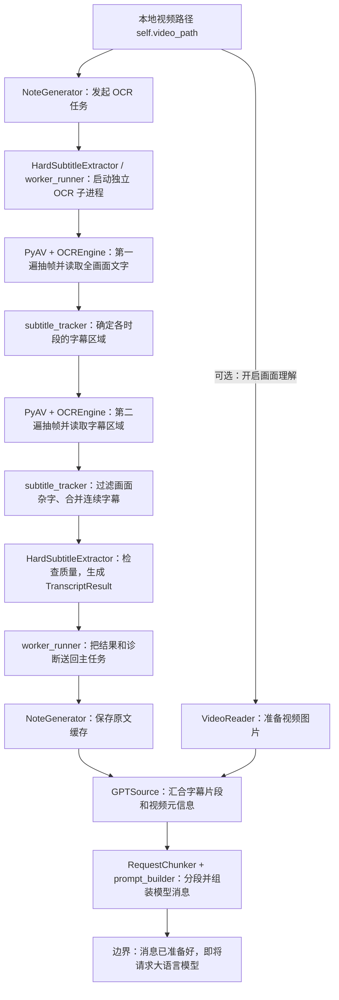

# 从本地视频到大语言模型输入：OCR 数据流程

本文从**本地视频文件已经获取**开始，说明画面字幕 OCR 如何形成原文，以及原文如何被整理成准备发送给大语言模型的消息。下载视频、模型实际生成笔记及生成后的 Markdown 处理不在本文范围内。OCR 路径读取的是视频画面，不执行语音转写。这里描述的是**选择 OCR、且没有命中可用原文缓存或平台字幕**时的路径；命中这些内容时，主任务会跳过 OCR。

## 一张图看流程



## 字幕是怎样从视频里提取出来的

可以把整个过程理解为：**先巡查整部视频，找字幕通常出现在哪里；再从头看一遍，只读这些位置的文字；最后把连续画面里的同一句话合成一条字幕。**

下面按当前代码的实际执行顺序讲。采样间隔和时间段长度使用默认配置；它们可以调整。

### 第一步：接收视频，准备识别器

主任务 `NoteGenerator` 拿到本地视频路径，确认本次需要 OCR，然后启动独立的 OCR 子进程。子进程初始化 RapidOCR 的文字识别器，再打开视频读取时长。主任务等待结果，同时接收子进程发回的进度。

这里读的是画面上已经显示出来的字幕。视频里说了话、但画面没有显示字幕的内容，不能通过这条流程提取。

### 第二步：第一遍从头看完整个视频，少量抽帧

视频本身由连续画面组成。PyAV 按顺序把视频解码成帧，程序查看每帧的时间戳，默认约每 **2 秒**选一帧做 OCR。没有被选中的帧不做 OCR。

选中的帧会在内存中变成一张图，过宽的画面先缩到最多 1280 像素，再交给识别器。识别器查看**整个画面**，返回“文字在哪里、写了什么、识别有多可信”。处理完这张图，程序继续向后读取。

所以，它并没有先导出一大堆图片文件。两遍扫描都采用一帧接一帧的处理方式，保留下来的主要是文字和位置记录。**抽帧减少的是送去 OCR 的图片数量；当前实现仍需顺序解码视频中的帧。**

### 第三步：用这些样本判断各段视频的字幕在哪里

第一遍获得的样本默认按 **20 秒**分成一组。例如，前 20 秒通常会有约 10 张抽样画面的识别记录。

`subtitle_tracker` 把这些记录放在一起比较：哪些文字经常出现在相近位置，内容又随时间变化？讲话字幕通常会“位置比较稳定，句子不断变化”；不变的标题、菜单，以及横向移动的弹幕，通常不符合这个特点。程序用这些线索给候选位置排序，选择有足够证据的字幕区域。

它没有统一规定字幕必须在底部。它为不同时间段分别判断；如果这一段前后字幕位置改变，或者多个文字区域竞争，就进一步拆小时间段再判断。两行相邻字幕也会尝试一起纳入区域。

这一步完成后，得到的是类似这样的安排：

```text
0～20 秒：看画面下方的这一条区域
20～30 秒：继续看这一条区域
30～40 秒：字幕位置改变，改看另一条区域
40～50 秒：证据不足，暂时标记为不确定
```

这是示意，不代表区域只能按整十秒变化。第一遍得到的文字主要用来定位，正式字幕主要由第二遍生成。

### 第四步：再检查一遍定位结果，处理短暂的空缺

程序参考全片中已经可靠定位的字幕区域，尝试解决某些时间段的竞争和空缺。例如，前后都有稳定字幕，中间短暂出现的菜单文字就不应轻易改变字幕位置；一句字幕长时间没有变化，也可能让第一遍难以确定位置。

只有具备足够的前后或连续位置证据，程序才会补足或修正定位。仍然无法确定的时间段保留标记。如果全片都没有可靠区域，就结束本次 OCR，返回“未检测到字幕”或“无法可靠定位”。

### 第五步：第二遍重新从头看，更密地抽帧

第一遍全部完成、字幕区域确定后，程序重新打开视频，从头解码。默认每秒选择 **5 帧**，大约每 0.2 秒查看一次字幕。

对于每张抽中的画面，程序先根据时间戳查到“这一时刻应该看哪块区域”，再从原始画面里裁出那一条字幕带，交给 OCR。

这样，第二遍主要识别字幕附近的小图，减少画面其他文字的干扰。视频仍然需要解码出画面，裁剪发生在得到这一帧之后；没有可靠区域的时间段跳过字幕 OCR。

### 第六步：读出每个时刻的字幕文字

RapidOCR 在裁下的小图里找到文字框并识别内容。程序再筛掉明显的边缘误检、偏离字幕位置的杂字，以及低可信度的文字。

如果一张图里有多个合格文字框，就按画面位置排列并拼接。于是，这张图变成一条观察记录：

```text
10.0 秒：今天介绍缓存的作用
10.2 秒：今天介绍缓存的作用
10.4 秒：今天介绍缓存的作用
10.6 秒：它可以减少重复计算
```

这时保存的是“时间戳 + 字幕文字 + 可信度”。程序接着处理下一张图；当前没有因为上一张图识别出了相同文字，就自动跳过这一张的 OCR。

### 第七步：把连续画面里的同一句话合成一条字幕

第二遍扫描完成后，`merge_observations` 沿时间轴顺序查看这些记录。

相邻采样时刻出现相同文字，就延长这一条字幕的结束时间；文字改变或时间间隔明显断开，就开始新的一条。前面的示例会整理成：

```text
约 10.0～10.6 秒：今天介绍缓存的作用
约 10.6 秒起：它可以减少重复计算
```

程序还会尝试消除少量“前后相同，中间只有一帧识别略有偏差”的抖动。涉及数字、否定词或部分运算符的差异会谨慎保留，避免把含义不同的句子合并。

相同句子隔很久再次出现时仍然是另一条字幕。这一步处理的是**时间上连续的重复**。开始和结束时间来自抽样帧，因此精度受抽帧间隔限制。

### 第八步：检查整份字幕是否足够可靠

程序检查扫描是否接近视频末尾、是否存在过多无法定位的时间、长时间没有识别到文字，以及低可信度结果比例是否过高。

通过检查后，得到带开始时间、结束时间和文字的字幕片段，并把各片段连接成全文。结果统一装进 `TranscriptResult`。

检查未通过时，程序保存诊断和可用的部分字幕，但主任务不会继续把这些结果交给总结模型。因此，“已经识别出一些文字”和“本次 OCR 成功”是两个不同的判断。

### 第九步：交回主任务，准备模型输入

OCR 子进程把结果交回 `NoteGenerator`。只有状态为 `success`，主任务才保存正式原文缓存，再将字幕片段、视频标题等整理成 `GPTSource`。

随后总结器把字幕变成“时间 - 文字”，按请求大小分段，并配上笔记要求，形成准备发送给大语言模型的消息。到这里，视频画面才完成了向模型输入文本的转换。

### 哪些工作并行，哪些工作串行

| 工作 | 当前执行关系 |
| --- | --- |
| 主任务接收进度与 OCR 子进程处理视频 | **同时运行**。主任务中的读取线程接收子进程输出，用来更新进度和发现卡住的任务。 |
| 第一遍抽帧、每帧 OCR | **逐帧串行**。识别当前抽样帧后，再继续读取后面的帧。 |
| 第一遍扫描 → 定位字幕区域 → 第二遍扫描 → 合并 → 质量检查 | **依次完成**。第二遍需要第一遍得到的位置；合并要等第二遍扫描完成。 |
| 第二遍取帧、裁剪、OCR、筛选文字 | **逐帧串行**。当前代码没有用多个 OCR 工作进程同时识别不同帧，也没有专门将解码与 OCR 做成并行流水线。 |
| 单张图片内部的识别计算 | 由 RapidOCR、ONNX Runtime 及所选 CPU/GPU 执行；底层可以使用计算线程或 GPU 并行计算。 |

独立子进程主要用于隔离解码和识别异常、监控进度。它本身不会让同一个视频里的多个帧同时识别。当前整体耗时主要沿着两遍扫描逐步累积。

## 各模块做什么、如何衔接

| 顺序 | 模块 | 接收什么 | 解决什么问题 | 交给下一个模块什么 |
| --- | --- | --- | --- | --- |
| 1 | [NoteGenerator](backend/app/services/note.py) | 已获取视频的本地路径 `self.video_path`、任务参数 | 确定本次需要 OCR，创建进度回调并调用字幕提取器 | 视频路径、诊断文件路径、进度回调 |
| 2 | [HardSubtitleExtractor](backend/app/services/hard_subtitle_extractor.py) + [worker_runner](backend/app/ocr/worker_runner.py) | 视频路径和 OCR 参数 | 将解码和 OCR 放到独立子进程；主任务接收进度，防止底层库卡住整个任务 | 子进程中的提取任务 |
| 3 | [worker](backend/app/ocr/worker.py) + [OCREngine](backend/app/ocr/ocr_engine.py) | 视频画面 | 初始化 RapidOCR 的文字检测、方向分类和文字识别模型；把画面文字整理为“位置、文字、置信度” | 每个抽样画面的文字框 `TextBox` |
| 4 | [HardSubtitleExtractor.frames](backend/app/services/hard_subtitle_extractor.py) | 视频文件 | 第一遍用 PyAV 顺序读取全片，约每 2 秒取一帧，让 OCR 查看**全画面** | 带视频时间戳的文字框样本 |
| 5 | [subtitle_tracker](backend/app/ocr/subtitle_tracker.py) | 各时刻的全画面文字框 | 按时间窗口确定哪一块是字幕区域，处理字幕位置变化和画面其他文字竞争；无法可靠判断的窗口保留为不确定 | 各时段的字幕区域 `roi`、候选文字及不确定标记 |
| 6 | [HardSubtitleExtractor](backend/app/services/hard_subtitle_extractor.py) + `OCREngine` | 视频及各时段字幕区域 | 第二遍读取全片，默认每秒取 5 帧；只裁剪已定位且可靠的字幕区域，再做 OCR | 带时间戳的字幕区域文字框 |
| 7 | `subtitle_tracker` + `HardSubtitleExtractor` | 字幕区域文字框 | 排除区域边缘图案、代码或菜单等不符合字幕位置的文字；保留可信结果，合并相邻帧中连续出现的相同字幕 | `TranscriptSegment(start, end, text)` 列表 |
| 8 | `HardSubtitleExtractor` | 分段字幕和各窗口诊断 | 检查是否扫完整片、是否存在明显缺失区域、长时间无字或识别不稳定；整理正式结果与诊断 | 成功时的 `TranscriptResult`；同时写入 OCR 诊断 JSON |
| 9 | `worker_runner` → `NoteGenerator` | 子进程输出的结果和诊断 | 把子进程结果还原给主任务；主任务只在 OCR `success` 时继续，并给原文附上输入身份和缓存签名 | 保存到 `note_results/<task_id>_transcript.json` 的原文 |
| 10 | [GPTSource](backend/app/models/gpt_model.py) + [UniversalGPT](backend/app/gpt/universal_gpt.py) | 原文片段、视频标题、标签及可选图片等 | 将原文变成总结模块统一接收的数据；把每条字幕整理成“开始时间 - 文字” | 待放入提示词的分段字幕和元信息 |
| 11 | [RequestChunker](backend/app/gpt/request_chunker.py) + [prompt_builder](backend/app/gpt/prompt_builder.py) | 分段字幕和元信息 | 长内容按请求大小切分，再加上标题、标签、笔记格式和风格要求，构成模型消息 | `messages`：准备交给大语言模型的请求内容 |

## 模块之间传递的数据长什么样

下面只列主要字段，便于对应上面的箭头：

```text
视频文件路径
  ↓
抽样结果：时间戳 + [TextBox(画面坐标, 文字, 置信度), ...]
  ↓
定位结果：时间范围 + 字幕区域 roi + 候选区域 + 是否不确定
  ↓
字幕观察值：时间戳 + 字幕文字 + 置信度
  ↓
TranscriptResult
  ├─ segments: [TranscriptSegment(start, end, text), ...]
  ├─ full_text: 合并后的全文
  ├─ language: 语言
  └─ raw: OCR 来源、设备和质量信息等
  ↓
GPTSource：segments + 标题 + 标签 + 可选视频图片 + 笔记要求
  ↓
模型消息 messages：带时间的字幕文本 + 提示词 + 可选图片
```

当前总结流程主要将 `transcript.segments` 交给 `GPTSource`，再按每段的**开始时间和文字**组装模型输入。`full_text` 也随原文一起保存；当前模型输入以 `segments` 为主。若开启“画面理解”，[VideoReader](backend/app/utils/video_reader.py) 准备的图片地址会在 `GPTSource` 汇合；它是独立于 OCR 字幕提取的可选支路。

## 结果、缓存与停止条件

- OCR 子进程通过 `OCR_PROGRESS` 把“定位字幕 / 提取字幕”的进度传给主任务；诊断默认写入 `note_results/<task_id>_ocr_diagnostics.json`。
- 只有质量检查通过、状态为 `success`，主任务才保存正式原文并进入模型消息准备阶段。`uncertain`、`no_subtitles` 或 `failed` 会停止这条 OCR 路径，不把不可靠原文交给总结模型。
- 正式原文默认写入 `note_results/<task_id>_transcript.json`；缓存签名包含输入身份和 OCR 相关配置，重试时可判断旧原文是否适用于当前任务。
- 本文终点是 `UniversalGPT` 已将内容整理为 `messages`，**尚未调用**实际的大语言模型请求。后续模型生成、分段结果合并及 Markdown 保存属于下一段流程。

相关的性能优化方向见 [OCR_推理加速路线图.md](OCR_推理加速路线图.md)。
