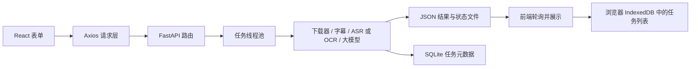

# BiliNote 全栈结构与知识点

> 历史学习笔记：正文描述的是引入多用户登录、任务调度和共享媒体缓存之前的实现。当前项目已支持用户身份与数据隔离，任务调度及缓存行为请结合 [任务调度说明](../backend/TASK_SCHEDULING.md) 和最新源码理解；下文的默认并发数、历史存储和会话描述不代表当前行为。

本文参照 `libo` 中《零到全栈》教程的顺序，依次理解前端模块化、React、FastAPI、前后端联调、SQLite，以及状态与会话。讲解以本仓库当前代码为准；教程中的示例实现与 BiliNote 的实际实现有所不同。

## 一、先看全局：一次生成笔记经过哪里

浏览器负责输入和展示；FastAPI 负责校验、接收请求和调度；业务服务负责处理视频。数据分别落在 **SQLite、后端文件和浏览器存储**。理解这三个存储位置，是读懂项目的关键。

## 二、对应教程 4.1～4.2：模块化、Vite 和构建

教程先解释为何用 `import/export` 取代依赖 `<script>` 顺序的全局变量，再引入 Vite 处理开发服务和生产构建。本项目已经采用这套结构，而且使用 TypeScript：

- [`index.html`](../BillNote_frontend/index.html) 只留一个 `root` 挂载点，并加载 `main.tsx`。
- [`main.tsx`](../BillNote_frontend/src/main.tsx) 导入 React、全局样式和 `App`，把组件树挂到页面上。这就是 ES Module 的实际用法。
- [`package.json`](../BillNote_frontend/package.json) 声明 `dev`、`build`、`preview` 等脚本以及依赖。Node.js 运行 Vite；浏览器运行构建后的页面代码。
- [`vite.config.ts`](../BillNote_frontend/vite.config.ts) 配置 React 插件、Tailwind、`@` 路径别名、分包以及开发代理。

在 `BillNote_frontend` 目录执行 `npm run dev` 是开发模式；`npm run build` 生成 `dist`，供生产环境部署。项目的 [`Dockerfile`](../BillNote_frontend/Dockerfile) 也体现了这个过程：先安装依赖并构建，再把 `dist` 放进 Nginx 镜像。**部署的是构建产物，日常修改的是 `src` 源码。**

教程用简单网站说明“拆模块”。本项目的拆分更接近真实应用：`pages` 放页面，`components` 放可复用界面，`services` 封装接口调用，`store` 管共享状态，`hooks` 放复用逻辑。

## 三、对应教程 4.3～4.4：React、数据驱动和路由

教程的核心句是“改变数据，让界面随数据变化”。在本项目中可以从三个层次理解：

| 数据所在位置 | 项目例子 | 改变后会怎样 |
| --- | --- | --- |
| 组件内部 | [`NoteForm.tsx`](../BillNote_frontend/src/pages/HomePage/components/NoteForm.tsx) 的表单值、上传状态 | 输入、校验提示和按钮状态随之更新 |
| 跨组件共享 | [`taskStore`](../BillNote_frontend/src/store/taskStore/index.ts) 的 `tasks`、`currentTaskId` | 历史列表、当前笔记、任务状态一起更新 |
| URL | [`App.tsx`](../BillNote_frontend/src/App.tsx) 的 `/`、`/settings/model` 等路由 | 刷新或分享链接时仍能定位页面 |

例如，[`NoteHistory.tsx`](../BillNote_frontend/src/pages/HomePage/components/NoteHistory.tsx) 从 `taskStore` 取得 `tasks`，再用 `map` 渲染历史卡片。增加一条任务时，代码更新的是数组；React 据此重新显示列表，无须手动往 DOM 插入卡片。

本项目用 `react-router-dom` 管理路由。Web 端使用 `BrowserRouter`；桌面端使用 `HashRouter`，见 [`App.tsx`](../BillNote_frontend/src/App.tsx)。这也回应了教程提出的“前端路由刷新后 404”：Web 部署的 [Nginx 配置](../BillNote_frontend/deploy/default.conf) 用 `try_files ... /index.html` 把未知页面路径交回 React。

还有一个容易混淆的点：**React state 是运行中的界面状态，持久化是额外机制。** 本项目的任务列表通过 Zustand `persist` 和 `idb-keyval` 写入浏览器 IndexedDB，见 [`taskStore`](../BillNote_frontend/src/store/taskStore/index.ts)。所以刷新后列表能回来；它并不是从 SQLite 全量查询出来的。

## 四、对应教程 5.4：FastAPI 管什么，业务服务管什么

教程用一个 GET、一个 POST 说明 FastAPI 负责路由、请求解析、校验和响应。本项目把这些职责拆到了多层：

| 层 | 对应代码 | 职责 |
| --- | --- | --- |
| 启动与应用装配 | [`main.py`](../backend/main.py)、[`app/__init__.py`](../backend/app/__init__.py) | 启动 Uvicorn、初始化数据库、挂载路由和中间件 |
| 接口层 | [`routers/note.py`](../backend/app/routers/note.py)、`provider.py`、`model.py`、`config.py`、`chat.py` | 接收 HTTP 请求、校验参数、返回结果 |
| 业务层 | [`services/note.py`](../backend/app/services/note.py) 等 | 下载、提取文字、生成笔记、问答 |
| 存储层 | [`db/engine.py`](../backend/app/db/engine.py) 下的模型与 DAO | 建表、查询、写入 SQLite |

以 `POST /api/generate_note` 为例：[`VideoRequest`](../backend/app/routers/note.py) 是 Pydantic 请求模型，规定链接、平台、质量、模型和文字提取方式等字段。FastAPI 根据模型解析 JSON，并在字段不符合要求时给出校验错误。接口通过 [`app/__init__.py`](../backend/app/__init__.py) 的路由注册获得 `/api` 前缀。

这个接口**不会等几分钟再返回完整笔记**。它生成 `task_id`，提交到线程池后立即返回；前端再访问 `GET /api/task_status/{task_id}`。提交逻辑见 [`note.py`](../backend/app/routers/note.py)，轮询逻辑见 [`useTaskPolling.ts`](../BillNote_frontend/src/hooks/useTaskPolling.ts)。这比教程中的同步文本分析多了“长任务”这一层。线程池默认并发数为 3，可由 `TASK_MAX_WORKERS` 调整，见 [`task_serial_executor.py`](../backend/app/services/task_serial_executor.py)；文件名虽含 `serial`，当前实现实际是并发线程池。

## 五、对应教程 5.5：前后端如何联调，CORS 何时出现

前端的 [`request.ts`](../BillNote_frontend/src/utils/request.ts) 创建 Axios 实例，默认请求基址为 `/api`，并把后端统一响应 `{code, msg, data}` 中的 `data` 提取出来。业务接口再由 [`services/note.ts`](../BillNote_frontend/src/services/note.ts) 封装，组件无须每次处理底层响应格式。

开发时有两种路径：

1. `VITE_API_BASE_URL` 未设置时，浏览器请求前端地址下的 `/api/...`，由 [Vite 代理](../BillNote_frontend/vite.config.ts) 转给后端。
2. 设成 `http://127.0.0.1:8483` 这类绝对地址时，浏览器直接访问后端；若前端与后端的协议、主机或端口不同，就涉及 CORS。

后端在 [`main.py`](../backend/main.py) 配了 `CORSMiddleware`，允许指定的本地、浏览器扩展及 Tauri 来源，并开放方法和请求头。教程提到的 JSON `POST` 预检 `OPTIONS`，在直接跨源请求时就适用。排查联调问题可照教程的“三现场”：先看浏览器 **Network** 中的 URL、状态码和响应，再看后端终端日志，最后看浏览器 **Console** 的 CORS 或脚本错误。

Docker Compose 部署又不同：[外层 Nginx](../nginx/default.conf) 把页面请求转给前端容器，把 `/api/` 转给后端。浏览器面对的是同一个站点地址，通常不需要走跨源调用。Vite 的 `VITE_` 变量会进入前端构建产物，不能用来放 API 密钥。

## 六、对应教程 6.4～6.5：SQLite、表和存储分层

教程演示直接写 SQL，把 `history.json` 改成 SQLite。本项目默认也是 SQLite，但主要通过 **SQLAlchemy ORM** 操作：连接配置在 [`engine.py`](../backend/app/db/engine.py)，默认 URL 为 `sqlite:///bili_note.db`；从 `backend` 目录运行时，对应 `backend/bili_note.db`。启动时 [`init_db.py`](../backend/app/db/init_db.py) 创建表，并对已有安装做一处字段补充。配置项 `DATABASE_URL` 可指定其他数据库，但本仓库展示的默认部署是 SQLite。

主要关系表如下：

| 表 | 主要字段 | 用途 |
| --- | --- | --- |
| [`providers`](../backend/app/db/models/providers.py) | `id`、`name`、`api_key`、`base_url`、`enabled` | 保存大模型供应商配置 |
| [`models`](../backend/app/db/models/models.py) | `id`、`provider_id`、`model_name`、`supports_image_input` | 保存模型及能力信息 |
| [`video_tasks`](../backend/app/db/models/video_tasks.py) | `video_id`、`platform`、唯一的 `task_id`、`created_at` | 保存视频与任务的对应关系 |

在教程的 SQL 视角里，[`video_task_dao.py`](../backend/app/db/video_task_dao.py) 的 `db.add(...); db.commit()` 对应 `INSERT` 加事务提交；`filter_by(...).order_by(...).first()` 对应带 `WHERE`、`ORDER BY`、`LIMIT` 的 `SELECT`。ORM 改变的是 Python 写法，数据库最终执行的仍是 SQL。这里的 `task_id` 唯一约束也会帮助按任务 ID 定位记录。

**但 SQLite 没有保存完整笔记正文。** 项目实际采用混合存储：

| 内容 | 实际位置 |
| --- | --- |
| 供应商、模型、视频任务元数据 | SQLite |
| 笔记结果、状态、转写缓存 | `NOTE_OUTPUT_DIR` 下的 JSON 等文件；见 [`routers/note.py`](../backend/app/routers/note.py) |
| 页面历史任务列表 | 浏览器 IndexedDB，见 `taskStore` |
| 问答聊天记录 | 浏览器本地持久化，见 [`chatStore`](../BillNote_frontend/src/store/chatStore/index.ts) |
| 笔记问答的检索索引 | [ChromaDB 本地持久化目录](../backend/app/services/vector_store.py) |
| 转写器、下载器 Cookie、代理设置 | 后端配置 JSON，例如 [`transcriber.json` 管理器](../backend/app/services/transcriber_config_manager.py) |

因此，“数据库里有任务记录”与“数据库里有完整笔记和前端历史列表”是两件事。教程的“接口层—业务层—存储层”思路适用，但本项目的存储层同时包含关系表、普通文件、向量库和浏览器存储。

## 七、对应教程 6.6：状态、会话与大模型上下文

本项目至少有四种不同的“状态”，不要把它们统称为 session：

1. **界面状态**：当前选中的任务、表单输入、弹窗是否打开，由 React/Zustand 管。
2. **任务状态**：`PENDING`、`TRANSCRIBING`、`SUMMARIZING`、`SUCCESS` 等，由后端写入状态文件，前端按 `task_id` 轮询。
3. **持久化数据**：SQLite 的配置和任务元数据，以及笔记结果文件，重启后仍可读取。服务重启时还会处理未完成任务的状态，见 [`task_recovery.py`](../backend/app/services/task_recovery.py)。
4. **大模型对话上下文**：前端按任务保存聊天记录，请求 `/api/chat/ask` 时带上 `history`；后端取最近 20 条消息，加检索内容和当前问题后调用模型，见 [`ChatPanel.tsx`](../BillNote_frontend/src/pages/HomePage/components/ChatPanel.tsx) 与 [`chat_service.py`](../backend/app/services/chat_service.py)。模型的“记得上文”来自每次请求重新传入上下文。

这里与教程有一项**重要差异**：教程 6.6 的历史隔离方案是 `session_id + Cookie + 数据库 WHERE session_id = ?`。本项目的任务表、相关路由和前端请求封装中没有这套机制。这里的 `task_id` 是任务标识，**不是登录身份，也不是教程中的 session ID**；浏览器各自显示的历史，主要来自各自的本地存储。因而不能把“本地历史列表看起来分开”理解为后端已经完成用户级访问隔离。

## 八、按一条实际链路复习

1. [`NoteForm`](../BillNote_frontend/src/pages/HomePage/components/NoteForm.tsx) 用 Zod 校验输入，补齐请求字段，调用 `generateNote`。
2. Axios 发 `POST /api/generate_note`；FastAPI 用 `VideoRequest` 再做服务端校验。
3. 后端生成 `task_id` 并提交任务；前端立即把它加入 `taskStore`，界面显示等待中。
4. [`NoteGenerator`](../backend/app/services/note.py) 获取平台字幕；没有可用字幕时按选项执行 ASR 或 OCR，然后调用大模型总结、处理截图和链接。
5. 后端把任务元数据写入 SQLite，把完整结果和状态写入文件；前端每 3 秒轮询状态，成功后更新界面与浏览器历史。
6. 用户打开问答时，后端从结果文件建立向量索引；提问时结合检索片段与前端传来的对话历史生成回答。

这条链路就是本项目版的“全栈”：**URL 和组件决定看到什么，HTTP/API 连接前后端，服务层完成耗时业务，按数据特点选择存储位置，状态机制把多次交互串起来。**

## 教程原文索引

- 前端：[4.1 现代前端基础——模块化](../libo/【零到全栈】4.1-现代前端基础——模块化.md)、[4.2 Vite、npm 与前端构建](../libo/【零到全栈】4.2-Vite、npm与前端构建.md)、[4.3 React、前端开发规则](../libo/【零到全栈】4.3-React,前端开发规则.md)、[4.4 数据驱动界面](../libo/【零到全栈】4.4-数据驱动界面.md)。
- 后端与联调：[5.4 FastAPI 入门](../libo/【零到全栈】5.4-FastAPI入门.md)、[5.5 前后端联调和 CORS](../libo/【零到全栈】5.5-前后端联调和CORS.md)。
- 数据与状态：[6.4 SQL 与 SQLite](../libo/【零到全栈】6.4-数据库正传--SQL与SQLite.md)、[6.5 在项目中使用 SQLite](../libo/【零到全栈】6.5-重构, 在项目中使用SQLite.md)、[6.6 状态与会话](../libo/【零到全栈】6.6-状态与会话.md)。
